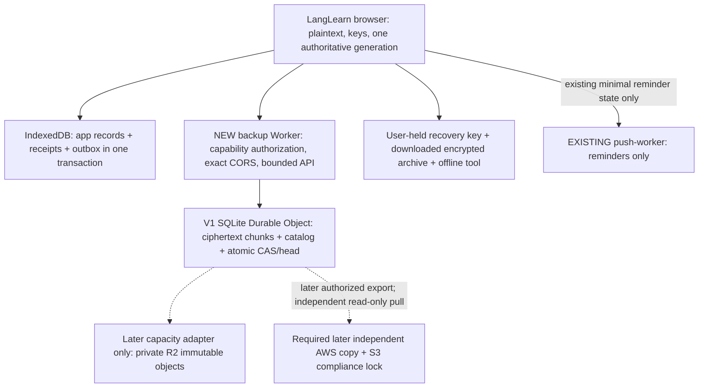

# Data durability: recoverable learning history

**Design and verification date:** 2026-11-17. **Status:** the bounded v1 encrypted
checkpoint layer is **implemented and locally verified, not deployed**.
There is no production off-device protection yet. The separate PR #49 local
recovery fix is already shipped.

**Evidence versions:** historical incident and persistence evidence is pinned to
[`4a6965917943138189366fa1a3a9ddf6ce967fea`](https://github.com/truemichato/langlearn/tree/4a6965917943138189366fa1a3a9ddf6ce967fea),
the merged PR #49 baseline. New v1 implementation, helper and test links refer
to the **current feature branch**, not to files at that earlier commit.
Later stable-identity, transactional app-state and independent-provider sections
are explicitly a hardening roadmap, not implemented guarantees.
Queued-checkpoint, restore-sidecar and browser-state conflict guards are
implemented with local unit/contract coverage (§17). The final ten-check
desktop-browser gate also passed, including fourth-profile native journal
fault/retry/export verification. This is not a full-atomicity or zero-loss guarantee.

## 1. Decision and the promise we can honestly make

The implemented first layer keeps offline study and adds **capability-authenticated, encrypted immutable
full checkpoints in a new Cloudflare Worker + per-vault SQLite Durable Object**.
At v1's small payload limits, the Durable Object stores ciphertext chunks and
CAS/head/idempotency metadata in **one SQLite transaction**. **No R2 or Auth0 is
required for v1.** Enrollment uses a manually entered server-only deployment
secret; each vault has independent random read/write capabilities and an
AES-256-GCM key. A recovery kit must be saved independently before opting into
automatic backup. The notification worker is never a backup backend.

The recommended evolution of this **one architecture**, not competing options:

1. **Bounded v1 now:** coherent full checkpoints, persistent exact retry bytes,
   atomic server append, readback/decryption before confirmation, recovery kit
   and fresh-browser/file recovery. Confirm only the exact checkpoint checked.
2. **Required later durability stages:** stable identities, transactional local
   app-state/receipt/outbox migration, deliberate single-writer handoff, complete
   independently recoverable catalog, and **AWS S3 with versioning and 30-day
   compliance Object Lock** under separate administration.
3. **Capacity extension only when needed:** move immutable ciphertext from
   SQLite into private R2, preserving the protocol and complete catalog. This
   introduces cross-service failure windows; do not pay that complexity at v1
   sizes. The R2-specific algorithms below specify that later adapter, not
   functionality present in the initial Worker.

Cloudflare alone is one provider/administrative domain. Until stage 2, the
system must not claim survival of its owner's Cloudflare-account loss, every
local split-store failure, or all pending/offline changes. Restore-generation
switching, global identities, atomic app-state migration, key wrapping and
device epochs below are **future design**, not v1 guarantees.

For the hardened stages use **one writing device per vault epoch**, with deliberate device handoff.
Preserve stale/offline branches instead of automatically merging them. This is
a backup and disaster-recovery system, not a collaborative synchronization
product. It deliberately avoids a CRDT, answer-text-based deduplication, and
last-writer-wins replacement of learning history.

The desired contract is:

> A confirmed off-device recovery point can be restored after this browser,
> its entire origin storage, or the device disappears, provided an authorized
> copy and its independent decryption material still exist. Accepted history
> is versioned; an accidental wipe cannot delete every recovery point.

This is **not** an absolute “data can never be lost” guarantee:

- Work only saved locally can disappear with the device or origin. Offline
  progress cannot have zero off-device recovery-point objective.
- A browser transaction completing is not a promise against site-data clearing,
  OS/storage failure, or browser defects. Request strict IndexedDB durability
  where supported; it is a durability **hint**, not independent backup.
- Encryption cannot recover a lost key. Authorization alone must not decrypt learner
  content, and an operator must not claim to recover an unknown recovery key.
- No bounded retention policy protects a mistake discovered after every
  retained useful version expires.
- A compromised unlocked app can read its user's data and create bad writes.
  Version retention and a separate administrative copy limit damage; they do
  not make XSS harmless.
- Correlated failure of all copies, all recovery materials, and all operators
  remains outside the guarantee. Explicit account erasure intentionally ends
  recovery, subject to the disclosed immutable-retention delay.

Local-only mode remains available without an account. It must say **“Saved on
this device”**, not “backed up” or “protected.”

### First principles for a newcomer

IndexedDB is the browser's structured database. localStorage is a separate
key/value store. Neither is the phone's photo backup, an installed-app account,
or a remote server. A service worker cache primarily makes the app available
offline; caching the app does not back up the learner's history.

A **checkpoint** is a complete, internally consistent recovery point. An
**operation segment** contains changes committed after a checkpoint. An
**outbox** records changes that must still be sent, in the same transaction
that saves the changes. A **receipt** makes applying an operation twice have
the same effect as applying it once. A **tombstone** records a deliberate item
deletion without immediately destroying older backups. A **vault** is one
learner's encrypted backup namespace, not a shared study group.

Independent means independent of the failure being protected against. Another
IndexedDB database, Cache API entry, localStorage copy, or OPFS directory on the
same origin is useful redundancy, but not an independent off-device copy.
Two Cloudflare buckets, regions, or Cloudflare accounts are also not the second
provider/administrative failure domain selected here.

## 2. What happened, what is fixed, and what is not known

The reported pattern was loss of words, lesson completion, study/streak history,
and resolved manual-set members, while localStorage XP, displayed badges, and
set definitions survived. That is consistent with IndexedDB being unavailable
or reset while localStorage survived. It does **not** prove browser eviction,
a migration failure, explicit deletion, or any particular initiating event.
We cannot inspect the affected phone's prior storage.

The earlier implementation admitted the app while recovery was still opening,
refreshed capsules only at startup, and could let a surviving badge obscure
missing history and replace a useful capsule. Reported incident verification
reproduced the regression red in a real browser before the PR #49 repair.
Baseline validation recorded 1,337 passing tests across 98 files and a passing
build, with six pre-existing lint errors and one warning. These are historical
baseline results; feature-layer validation is recorded separately in §17.

**Reported production verification:** the immediate
local safeguards are now shipped. Fresh workflow dispatch **43992857453**
succeeded; production `/LangLearn/assets/index-CktsSFFX.js` was byte-identical
to the verified local build, and an actual browser loaded that
hash. The earlier artifact-lookup zero/duplicate-artifact retry issue was resolved
with the fresh dispatch. These are recorded deployment observations, not checks
rerun during documentation reconciliation.
There is **no remaining GitHub Pages deployment blocker** for PR #49.

### Shipped baseline safeguards — pinned source evidence

| Existing safeguard | Evidence | Important limit |
| --- | --- | --- |
| Study routes, onboarding, and timers wait for the boot result | [App gate](https://github.com/truemichato/langlearn/blob/4a6965917943138189366fa1a3a9ddf6ce967fea/src/App.tsx#L37-L79), [boot lifecycle](https://github.com/truemichato/langlearn/blob/4a6965917943138189366fa1a3a9ddf6ce967fea/src/hooks/useDatabaseBoot.ts#L42-L115) | Does not supply a remote copy |
| Open/version/blocked states are distinguished; native connection invalidation closes the connection and requires reload | [recovery state machine](https://github.com/truemichato/langlearn/blob/4a6965917943138189366fa1a3a9ddf6ce967fea/src/db/recovery.ts#L55-L111), [invalidation/open](https://github.com/truemichato/langlearn/blob/4a6965917943138189366fa1a3a9ddf6ce967fea/src/db/recovery.ts#L336-L407) | Closed/disconnected is not proof of deletion; do not reopen through an incidental component query |
| Recovery capture follows committed Dexie mutations, coalesces at about one second, and tries a visibility flush | [capture lifecycle](https://github.com/truemichato/langlearn/blob/4a6965917943138189366fa1a3a9ddf6ce967fea/src/db/recovery-capsule.ts#L283-L338) | Asynchronous, best effort; closing/killing a browser can preempt capture |
| Capsules preserve useful, unreadable, or newer-format bytes rather than replacing them with missing history | [capsule write rules](https://github.com/truemichato/langlearn/blob/4a6965917943138189366fa1a3a9ddf6ce967fea/src/db/recovery-capsule.ts#L160-L207), [history evidence](https://github.com/truemichato/langlearn/blob/4a6965917943138189366fa1a3a9ddf6ce967fea/src/db/recovery-history.ts#L14-L86) | Heuristics detect certain missing areas, not every partial loss or corruption |
| Table snapshots use coherent read transactions | [export read](https://github.com/truemichato/langlearn/blob/4a6965917943138189366fa1a3a9ddf6ce967fea/src/db/backup.ts#L100-L114), [pre-upgrade read](https://github.com/truemichato/langlearn/blob/4a6965917943138189366fa1a3a9ddf6ce967fea/src/db/recovery.ts#L418-L455) | localStorage is read separately; the pre-upgrade payload is held in memory until the upgrade completes |
| Missing-progress recovery is additive, retains numeric IDs, requires a safety snapshot in its transaction, and refuses incompatible word/text/review ID collisions | [additive recovery](https://github.com/truemichato/langlearn/blob/4a6965917943138189366fa1a3a9ddf6ce967fea/src/db/backup.ts#L404-L493), [recovery entry](https://github.com/truemichato/langlearn/blob/4a6965917943138189366fa1a3a9ddf6ce967fea/src/db/recovery.ts#L311-L329) | Not a general cross-device identity or conflict protocol |
| Routine snapshot pruning avoids displacing missing-history evidence | [snapshot retention](https://github.com/truemichato/langlearn/blob/4a6965917943138189366fa1a3a9ddf6ce967fea/src/db/recovery.ts#L239-L287) | Nominal three-copy limit can be exceeded for protected evidence; copies are inside the same database |
| Persistent storage is requested, and manual export is available | [persistence API calls](https://github.com/truemichato/langlearn/blob/4a6965917943138189366fa1a3a9ddf6ce967fea/src/lib/storage-persistence.ts#L69-L107), [data controls](https://github.com/truemichato/langlearn/blob/4a6965917943138189366fa1a3a9ddf6ce967fea/src/components/settings/DataSafetySection.tsx#L80-L169) | Browser grant/install status is not a backup guarantee |

Baseline recovery points remain available after dismissal. A recovery-screen
restore is additive; Settings' explicitly confirmed snapshot restore is a
point-in-time replacement. These distinctions must remain understandable.

### Remaining gaps that this design closes

1. Total origin clearing removes database, snapshots, capsules, local keys,
   preferences, and any pending upload together.
2. The pinned baseline “all data” format covers 13 live tables and four localStorage
   stores, not every persisted key or in-progress activity.
3. localStorage settings/XP/set writes are not atomic with IndexedDB writes.
   Vocabulary receipts bridge one reward case, not every side effect.
4. Pre-upgrade snapshots are not yet independently durable **before** migration:
   [`pendingSnapshot`](https://github.com/truemichato/langlearn/blob/4a6965917943138189366fa1a3a9ddf6ce967fea/src/db/recovery.ts#L418-L469) is process memory until
   the new schema opens. Do not describe that window as crash-proof.
5. General import is not the new secure restore protocol. Its normalizer accepts
   table arrays without comprehensive record/referential validation, and storage
   restoration follows the IndexedDB transaction and can fail independently
   ([normalization](https://github.com/truemichato/langlearn/blob/4a6965917943138189366fa1a3a9ddf6ce967fea/src/db/backup.ts#L152-L200),
   [replace/storage](https://github.com/truemichato/langlearn/blob/4a6965917943138189366fa1a3a9ddf6ce967fea/src/db/backup.ts#L347-L400)). The Settings import caller
   does not require `takeSnapshot()` to return a useful copy before continuing
   ([caller](https://github.com/truemichato/langlearn/blob/4a6965917943138189366fa1a3a9ddf6ce967fea/src/components/settings/DataSafetySection.tsx#L114-L134)).
6. There is no account, independent key-recovery kit, remote catalog, durable
   upload acknowledgment, or tested total-clear cloud restore in this baseline.

These are design inputs, not changes silently included in PR #49.

## 3. Complete persistence inventory

The pinned baseline database is **`LangLearnDB`, schema v12**, not the older
v8/ten-table description:
[constants](https://github.com/truemichato/langlearn/blob/4a6965917943138189366fa1a3a9ddf6ce967fea/src/db/constants.ts#L1-L4),
[all entity declarations](https://github.com/truemichato/langlearn/blob/4a6965917943138189366fa1a3a9ddf6ce967fea/src/db/schema.ts#L24-L206),
[v12 stores](https://github.com/truemichato/langlearn/blob/4a6965917943138189366fa1a3a9ddf6ce967fea/src/db/schema.ts#L372-L417).

**Current learning-flow update:** schema **v13** adds `readingProgress`, making
14 full-export data tables plus the non-recursively-exported `snapshots` table.
It retains exact text/source identity, paragraph position, purpose,
highlighting and optional reflection. Current full backups, independent
encrypted payloads and local capsules include it; older schema payloads remain
supported. Compact capsules still omit `reviewLog`. Reading-only progress now
counts as recoverable history. Saved-text merges remap its text references;
conflicting nonempty reflections are rejected instead of overwritten.
Script-preparation deferral is the settings record
`guided-script-deferred-v1/<language>` with string value `'true'`, not a
completion record. These are additions to the historical inventory below,
not claims that the pinned commit already contained them. See
[reading continuity](./knowledge-practice.md#reading-purpose-and-continuation).

### 3.1 Every Dexie table

“Full” below means baseline JSON export and normal snapshot payload, not the
new encrypted payload. “Capsule” means baseline compact localStorage recovery.
The [actual export registry](https://github.com/truemichato/langlearn/blob/4a6965917943138189366fa1a3a9ddf6ce967fea/src/db/backup.ts#L25-L59) and
[capsule registry](https://github.com/truemichato/langlearn/blob/4a6965917943138189366fa1a3a9ddf6ce967fea/src/db/recovery-capsule.ts#L21-L34) are authoritative.

| Table; primary key | Contents and relationships | Full / capsule | Proposed disposition |
| --- | --- | --- | --- |
| `words`; numeric auto-ID | Word/reading/meaning/context, language/type/tags, `sourceTextId`, grammar fields, lesson-source IDs/aliases/snapshots, learner edits, creation time | Yes / yes | Authoritative; preserve local numeric ID and add global identity; preserve source ownership, not just displayed text |
| `reviews`; numeric auto-ID | `wordId`, SM-2 schedule, repetitions/ease/dates, optional FSRS stability/difficulty | Yes / yes | Authoritative; preserve word relationship and scheduler state |
| `texts`; numeric auto-ID | Learner-saved title, complete text, language/date; target of `words.sourceTextId` | Yes / yes | Authoritative private content |
| `studySessions`; numeric auto-ID | Start/end, duration/activity, time XP, optional language/wordCount/title; `endTime: null` can remain after a crash | Yes / yes | Authoritative committed effort; distinguish active cursor from historical row |
| `settings`; string `key` | Legacy preferences **and** attempts, reward receipts, frozen daily questions, compatibility evidence, notification mirrors and device state; see below | Yes / yes | Classify keys; learner records are authoritative, credentials are not portable |
| `dailyActivity`; date | Study seconds, reviews, added words, goal/challenge/freeze flags | Yes / yes | Preserve historical aggregates; not completely reconstructible from surviving logs |
| `lessonProgress`; language/lesson string ID | Completion, attempts, score/date and optional `completionMethod`, including test-outs | Yes / yes | Authoritative evidence; missing method remains ordinary lesson completion, not test-out |
| `characterProgress`; language/alphabet/character string ID | Counts, dates, romanization, mastery | Yes / yes | Authoritative; preserve exact key and text normalization |
| `testHistory`; numeric auto-ID | Scores/levels/question counts/duration/date/language/type | Yes / yes | Authoritative event history; not recoverable from XP |
| `badges`; badge string ID | Unlock date; also duplicated in the badge store | Yes / yes | Preserve earned unlock facts; reconcile duplicate representations without awarding again |
| `reviewLog`; numeric auto-ID | `reviewId`, `wordId`, language, grade/lapse/date | Yes / **no** | Authoritative detailed history; restore parent links or explicitly retain orphan evidence |
| `snapshots`; numeric auto-ID | Recovery reason/date/schema, serialized payload, byte count | **No / no** | Auxiliary recovery evidence. Export descriptors plus separately hashed payload artifacts; never recursively embed backups of backups |
| `guidedActivityProgress`; language/milestone string ID | Activity/completion/attempts/items/best score | Yes / yes | Authoritative |
| `skillProgress`; string ID | Language, numbers/minimal-pair activity, skill, attempts/correct | Yes / yes | Authoritative |

The full export intentionally excludes `snapshots` to prevent recursive
growth. The pinned baseline capsule includes 12 table families, excludes `reviewLog` and
`snapshots`, includes **only XP** from localStorage, and refuses payloads above
2,500,000 encoded bytes
([limits/shape](https://github.com/truemichato/langlearn/blob/4a6965917943138189366fa1a3a9ddf6ce967fea/src/db/recovery-capsule.ts#L11-L40),
[construction](https://github.com/truemichato/langlearn/blob/4a6965917943138189366fa1a3a9ddf6ce967fea/src/db/recovery-capsule.ts#L209-L240)).
Neither is an independent failure domain while stored in this origin.

### 3.2 Every persisted Zustand store and other browser key

There are seven current Zustand stores, **four** of which use `persist`.
Do not treat all stores as durable or assume the timer has its own persisted
Zustand key.

| Store/key | Actual durable values | Current full export / proposed policy |
| --- | --- | --- |
| `langlearn-settings`, version 1 | Weekly/daily minute goals; weekly word/review/lesson goals; active/current languages; stress marks, dark mode, font size, TTS rate; batch size/context display/adaptive review; onboarding; scheduler/FSRS retention; Arabic dialect/colloquial focus; streak freezes, grant milestone, recap week; all reminder preferences, presets, budgets, category thresholds/times/quiet hours, cloud toggle | Included. Migrate learning/preferences to authoritative `appState`; retain notification **preferences**, never assume browser permission or subscription transfers |
| `langlearn-xp`, version 2 | `bonusXP`, `creditedVocabAttempts: attemptId → amount` | Included; capsule also includes it. Migrate opaque historical bonus baseline and receipt tokens together; do not recompute by replay |
| `langlearn-badges`, version 1 | `unlockedBadges: id → date`, plus serialized `lastToast` | Included. Unlocks authoritative; `lastToast` is transient presentation and must not fire again after restore |
| `langlearn-study-sets`, version 2 | Set ID/name/description/type/tags/language/date, selection mode, numeric `wordIds`, smart filter, `_initialized` | Included. Custom definitions/membership authoritative; default smart sets reconstructible; initialization marker is not learner history |
| `langlearn-assessment-drafts`, version 1 | Up to three test-out drafts, frozen questions, index/correct count/selected choice, language/kind/lesson IDs/save time; current expiry seven days | **Omitted**. Migrate valid drafts to durable `drafts`; keep frozen questions. Mark expiry as a declared draft policy, not silent historical-data deletion; preserve invalid/future bytes as recovery artifacts |
| `langlearn-guided-${language}-${alphabetName}` | Completed guided letter-group names | **Omitted directly**. Some pre-v12 evidence is frozen in `settings`; later group changes are not reliably reconstructed from it. Migrate every matching owned key to authoritative progress in one bridge |
| `langlearn-recent-learn-activities` | Recent activity routes per language | Omitted; optional portable convenience state with validation, not knowledge evidence |
| `langlearn-practice-mode` | Review direction preference | Omitted; move to preference state; safe default if absent |
| `langlearn-full-path-guide-dismissed` | Full-path explanatory disclosure dismissal | Omitted; optional UI preference |
| `langlearn-recovery-capsule-v1` | Existing recovery payload/metadata, including XP tokens | Not nested in full export. Retain/export as an independent **artifact within the backup**, not active state to overwrite |
| `langlearn-data-loss-dismissed` | Timestamp identifying a dismissed recovery point | Omitted; device/recovery UI marker, never evidence of restored history |
| `langlearn-last-snapshot-date` | Routine snapshot scheduling marker | Omitted; reconstruct scheduling, do not restore as proof a backup exists |
| `langlearn-notification-plan-v2` | Scheduled plan and generation metadata | Omitted; reconstruct for this device after permission/consent |
| `langlearn-notification-fired` | Day/category delivery budget | Omitted; device delivery bookkeeping, not learning progress |
| `langlearn-notification-snooze` | Snooze timestamps | Omitted; device-local by default |
| `langlearn-celebrated-milestones` | Already-delivered notification milestones | Omitted; preserve locally; portable suppression summary may prevent duplicate celebration but awards must not depend on it |
| `langlearn-notification-dismiss-stats` | Notification open/dismiss tuning statistics | Omitted; device-local, bounded retention |
| `langlearn-shown-nudges` | Day and already-shown nudge IDs | Omitted; intentionally transient |
| `langlearn-triggered-tags` | Reconciliation with scheduled notification tags | Omitted; rebuild, not portable |
| sessionStorage `langlearn-study-tip-dismissed` | Current-tab tip dismissal | Omitted; intentionally ephemeral |
| sessionStorage `langlearn-update-applied` | One-shot service-worker update marker | Omitted; intentionally ephemeral |
| sessionStorage `ichimoe:${text}` | Dictionary/parser cache keyed by learner-selected text | Omitted; private content cache, discard rather than upload |

Evidence:
[settings fields](https://github.com/truemichato/langlearn/blob/4a6965917943138189366fa1a3a9ddf6ce967fea/src/stores/settingsStore.ts#L8-L93),
[settings persistence](https://github.com/truemichato/langlearn/blob/4a6965917943138189366fa1a3a9ddf6ce967fea/src/stores/settingsStore.ts#L201-L217),
[XP/tokens](https://github.com/truemichato/langlearn/blob/4a6965917943138189366fa1a3a9ddf6ce967fea/src/stores/xpStore.ts#L4-L89),
[badge store](https://github.com/truemichato/langlearn/blob/4a6965917943138189366fa1a3a9ddf6ce967fea/src/stores/badgeStore.ts#L4-L47),
[sets/migration](https://github.com/truemichato/langlearn/blob/4a6965917943138189366fa1a3a9ddf6ce967fea/src/stores/studySetsStore.ts#L4-L38),
[set persistence](https://github.com/truemichato/langlearn/blob/4a6965917943138189366fa1a3a9ddf6ce967fea/src/stores/studySetsStore.ts#L90-L124),
[assessment drafts](https://github.com/truemichato/langlearn/blob/4a6965917943138189366fa1a3a9ddf6ce967fea/src/lib/lesson-assessment-draft.ts#L3-L29),
[draft parsing/expiry](https://github.com/truemichato/langlearn/blob/4a6965917943138189366fa1a3a9ddf6ce967fea/src/lib/lesson-assessment-draft.ts#L114-L163),
[guided group keys](https://github.com/truemichato/langlearn/blob/4a6965917943138189366fa1a3a9ddf6ce967fea/src/lib/guided-learning-progress.ts#L23-L25),
[guided writes](https://github.com/truemichato/langlearn/blob/4a6965917943138189366fa1a3a9ddf6ce967fea/src/lib/guided-learning-progress.ts#L70-L106),
[recent activities](https://github.com/truemichato/langlearn/blob/4a6965917943138189366fa1a3a9ddf6ce967fea/src/lib/recent-learn-activities.ts#L1-L73),
[practice preference](https://github.com/truemichato/langlearn/blob/4a6965917943138189366fa1a3a9ddf6ce967fea/src/pages/Review.tsx#L24-L42),
[notification keys](https://github.com/truemichato/langlearn/blob/4a6965917943138189366fa1a3a9ddf6ce967fea/src/lib/notification-scheduler.ts#L34-L70),
[tip](https://github.com/truemichato/langlearn/blob/4a6965917943138189366fa1a3a9ddf6ce967fea/src/components/common/StudyTip.tsx#L16-L27),
[update marker](https://github.com/truemichato/langlearn/blob/4a6965917943138189366fa1a3a9ddf6ce967fea/src/lib/sw-update.ts#L123-L149),
[parser cache](https://github.com/truemichato/langlearn/blob/4a6965917943138189366fa1a3a9ddf6ce967fea/src/lib/ichimoe.ts#L14-L32).

### 3.3 Records hiding in `settings`, and state with no browser key

| Location | Meaning and coverage decision |
| --- | --- |
| `settings['vocab-attempt:v1:<encoded-language>:<encoded-lesson>']` | Full saved lesson, frozen exercise ordering/states, attempt UUID/revision/content revision, cursor and completion phase; already exported because the entire settings table is exported |
| `settings['vocab-receipt:v1:<attemptId>']` | Score, reward amount, completion date and pending/credited state; must travel with `creditedVocabAttempts` |
| `settings['vocab-attempt-recovery:v1:<uuid>']` | Original bytes of a deliberately restarted/replaced attempt; preserve as recovery evidence |
| `settings['daily-practice:v1:<date>:<language>']` | Frozen daily challenge questions/notices/knowledge revision; currently **not** a persisted per-answer cursor |
| `settings['guided-path-source-v1/<language>']` | Frozen legacy lesson/activity/group evidence from schema v12 |
| `settings['guided-path-baseline-v2/<language>']` | Compatibility baseline derived from frozen evidence and curriculum; preserve original plus version, allow explicit regeneration without inventing completion |
| `settings['notification-prefs']` | Service-worker preference mirror; derive again from authoritative preferences |
| `settings['push-endpoint']` | Device subscription endpoint/capability-like identifier. Current full/capsule exports contain it through blanket settings export; proposed portable checkpoints must exclude it |
| `settings['push-last-worker-check']`, `['push-last-sync-at']`, `['push-subscription-changed-at']`, `['last-sync-wake']` | Device push/background-sync bookkeeping; exclude from portable recovery state |
| `settings['sw-celebrated-milestones']`, `['sw-notification-fired']` | Service-worker delivery suppression/budget; device-local, not reward history |
| `timerStore` (no persisted key) | `isRunning`, elapsed, activity, numeric session ID, `lastFlushedSeconds`; partial progress lives in `studySessions` and `dailyActivity`, not the complete in-memory cursor. Current auto-flush is every 15 seconds and the session/daily writes are separate |
| `reviewStore` (no persisted key) | Queue/current index/flip/requeue/practice direction/grading lock/session counter; intentionally ephemeral. Scheduled grades persist; explicit practice grades remain memory-only |
| `nudgeStore` (no persisted key) | In-app nudge queue/callbacks; intentionally ephemeral |
| React-local forms/drawing/capture/drill state | Unsaved typing, canvas strokes, selection sheets, most activity cursors; not currently durable. No promise until a save/checkpoint commits. Do not serialize callbacks or whole component trees |
| Derived knowledge/analytics | Vocabulary evidence derives from saved lexical cards, current reviews, completed explicit lesson targets. No separate knowledge table; preserve inputs, source IDs, target-index/content revision, and invalidate derived caches after restore |
| Workbox/PWA/PushManager state | Precached app assets, service-worker registration/version, browser permissions, actual push subscription keys; browser-managed/reconstructible or device credentials, not portable learner records |

Evidence:
[attempt shapes](https://github.com/truemichato/langlearn/blob/4a6965917943138189366fa1a3a9ddf6ce967fea/src/lib/vocab-lesson-attempt.ts#L13-L78),
[attempt/recovery saves](https://github.com/truemichato/langlearn/blob/4a6965917943138189366fa1a3a9ddf6ce967fea/src/lib/vocab-lesson-attempt.ts#L157-L202),
[two-store receipt sequence](https://github.com/truemichato/langlearn/blob/4a6965917943138189366fa1a3a9ddf6ce967fea/src/lib/vocab-lesson-attempt.ts#L223-L273),
[daily freeze](https://github.com/truemichato/langlearn/blob/4a6965917943138189366fa1a3a9ddf6ce967fea/src/lib/daily-challenge.ts#L291-L338),
[v12 compatibility capture](https://github.com/truemichato/langlearn/blob/4a6965917943138189366fa1a3a9ddf6ce967fea/src/db/schema.ts#L388-L415),
[baseline resolution](https://github.com/truemichato/langlearn/blob/4a6965917943138189366fa1a3a9ddf6ce967fea/src/lib/learning-path.ts#L537-L563),
[push bookkeeping](https://github.com/truemichato/langlearn/blob/4a6965917943138189366fa1a3a9ddf6ce967fea/src/lib/push-subscription.ts#L12-L17),
[push writes](https://github.com/truemichato/langlearn/blob/4a6965917943138189366fa1a3a9ddf6ce967fea/src/lib/push-subscription.ts#L142-L200),
[SW keys](https://github.com/truemichato/langlearn/blob/4a6965917943138189366fa1a3a9ddf6ce967fea/src/sw.ts#L152-L174), [SW budget](https://github.com/truemichato/langlearn/blob/4a6965917943138189366fa1a3a9ddf6ce967fea/src/sw.ts#L210-L233),
[SW wake](https://github.com/truemichato/langlearn/blob/4a6965917943138189366fa1a3a9ddf6ce967fea/src/sw.ts#L267-L279),
[subscription change](https://github.com/truemichato/langlearn/blob/4a6965917943138189366fa1a3a9ddf6ce967fea/src/sw.ts#L484-L498),
[timer](https://github.com/truemichato/langlearn/blob/4a6965917943138189366fa1a3a9ddf6ce967fea/src/stores/timerStore.ts#L8-L151),
[scheduled/practice boundary](https://github.com/truemichato/langlearn/blob/4a6965917943138189366fa1a3a9ddf6ce967fea/src/stores/reviewStore.ts#L33-L85),
[nudges](https://github.com/truemichato/langlearn/blob/4a6965917943138189366fa1a3a9ddf6ce967fea/src/stores/nudgeStore.ts#L3-L30),
[knowledge inputs](https://github.com/truemichato/langlearn/blob/4a6965917943138189366fa1a3a9ddf6ce967fea/src/db/knowledge.ts#L7-L27),
[knowledge/capture contract](./knowledge-practice.md),
[PWA configuration](https://github.com/truemichato/langlearn/blob/4a6965917943138189366fa1a3a9ddf6ce967fea/vite.config.ts#L6-L39).

For the new format, maintain an explicit **persistence registry** with, for
every table/key/prefix: owner, schema validator, sensitivity, authority,
portability, expiry, references, migration and restore handler. CI compares
registered tables against Dexie and checks known storage writers against the
registry. Unknown owned keys are preserved as opaque encrypted artifacts and
reported as unsupported; arbitrary origin keys are never swept into a backup.
Recognized device credentials are filtered even when embedded in old exports.
Raw legacy artifacts containing such credentials require explicit encrypted
archive consent, remain inert, and must never reactivate a push subscription.

## 4. Failure model and the required response

| Failure | Detection/interpretation | Required response and boundary |
| --- | --- | --- |
| Database connection closed, blocked, or newer than bundle | Open error/versionchange/failed read; not an empty-array fallback | Stop writers/timers, preserve evidence, offer reload/export/recovery. Never delete/recreate to “fix” an open failure |
| Actual database deletion, browser eviction, site-data clearing | Missing database may be either fresh install or loss; localStorage is not authoritative proof | Recovery landing before blank initialization; independently saved kit/capability plus catalog/file restore. Persistence request and another same-origin copy do not solve this |
| Partial table loss or corruption | Registry/count/link/hash validation, committed-revision gaps, comparison with prior checkpoint | Quarantine questionable generation and upload as a fork if readable; preserve last verified useful head |
| Multi-tab stale code/service worker | Version/protocol/epoch/generation mismatch | Writer admission fails closed, close old native handles; no stale SW schema creation or backup writes |
| Bad migration or migration crash | Preflight/staging validation; interrupted bridge/activation journal | Verified pre-migration copy and generation rollback, no in-place destructive retry |
| Malformed, huge, malicious or future backup | Bounded parser, envelope/version/schema/link checks | Refuse activation; retain original file unchanged, identify required reader version |
| Quota or partial local writes | Transaction abort/QuotaExceededError/failed bridge write | No successful save UI, no partial reward/outbox. Keep prior active generation. Read-only/export if space cannot be made safely |
| Accidental item deletion | Explicit delete operation/tombstone | Hide from live view, retain earlier versions and links; undo by new operation |
| Bulk delete/wipe/unexpected empty store | Destructive command or anomalous coverage/count change | Pre-wipe verified safety pin; quarantine emptiness, never age out the only useful copy because of it |
| Device loss while offline or uploads pending | Pending commit sequence/oldest age | Restore last accepted recovery point; unsent work on lost device is unrecoverable |
| Worker, Durable Object, R2 or network failure | Typed retryable errors, pending intent/ack age | Continue local study within quota; durable retry, no false acknowledgment |
| Account/provider outage or account loss | Login/access fails | Encrypted downloadable archive + independent recovery kit; AWS administrative restore path; no unauthenticated ownership bypass |
| Key loss | Cannot unwrap master key/authentication failure | Explain limits; recover from another still-unlocked device or saved kit. Password reset is not decryption |
| Primary administrative compromise/deletion | Independent copier/audit alarm, missing primary objects | AWS retained versions and independent catalog/tool; two Cloudflare buckets do not count |
| Authorized account erasure | Recent reauthentication, explicit confirmation | Immediately stop uploads/access; purge on disclosed retention schedule, do not secretly retain indefinite “safety” copies |

Browser quotas and storage are origin-scoped, not scoped to `/LangLearn/`.
See [MDN quotas/eviction][mdn-quota] and [same-origin rules][mdn-origin].
Avoid fixed claims such as “Safari always deletes after seven days” or
“installation makes loss impossible”; test supported browser/install modes.

## 5. Trust boundaries and provider choice



### Selected service responsibilities

- **Static app:** remains deployable on GitHub Pages at
  `https://truemichato.github.io/LangLearn/`, with `/LangLearn/` base and
  HashRouter. Off-device backup is opt-in and not a prerequisite for studying.
- **New Cloudflare backup Worker:** separate code, deployment, hostname,
  service bindings, secrets and privacy text from `infra/push-worker/`.
  The existing push service must receive **no vocabulary, history, answers,
  saved texts, backups, vault keys, or backup authentication tokens**.
  Its existing [privacy boundary](./notifications.md#privacy) stays intact.
- **One SQLite-backed Durable Object per vault at v1:** stores immutable encrypted
  full-checkpoint records in 64 KiB internal chunks, catalog summaries and
  capability hashes. A transaction atomically appends all chunks, updates
  idempotency, checks parent CAS, advances sequence/head, and applies eligible
  retention pruning. There is no separate external-object PUT failure window.
- **Later private R2 Standard adapter:** use only when measured payload/storage
  capacity needs exceed the bounded SQLite tier. It stores ciphertext, encrypted
  manifests and complete immutable catalog records; SQLite retains coordination.
  No public `r2.dev` access or cached authenticated responses.
- **Required later AWS account with independent administration:** scheduled Lambda pulls
  accepted complete encrypted recovery archives through a scoped read-only
  export credential held in AWS Secrets Manager (or reads R2 if that adapter is deployed),
  writes S3 versioned objects with 30-day **compliance** retention, verifies
  bytes, and writes signed copy receipts. Cloudflare holds no AWS delete,
  retention-management or administrator credentials.

Why this division: bounded v1 keeps the checkpoint and its acceptance in one
transaction, avoiding an unnecessary service. Durable Object SQLite supplies
transactional storage and per-vault serialization. If R2 is introduced,
it is object storage, not a transactional multi-object database; its external
write cannot be included in that SQLite transaction
([SQLite API][cf-do-sqlite]). D1 is **not required** for correctness. If later
used for support/search/reporting, it is a rebuildable projection, never the only
catalog or source of upload acknowledgments. KV is not the head/CAS store.

R2 documents strong reads, writes and listing, including atomic conditional
object writes, but not a transaction spanning objects
([consistency][cf-r2-consistency]). A 404 while an earlier PUT is ambiguous
does not prove that PUT failed. Retry conditional creation of the **same bytes**
and compare the complete digest; never issue a conflicting overwrite.
Use private bindings/API reads, not a CDN cache, for catalog/restore verification.

R2 bucket-lock prefix/age policies provide another deletion guard but admins
can remove those rules ([bucket locks][cf-r2-locks]). They are neither
irreversible compliance retention nor administrative independence. S3 Object
Lock requires versioning; compliance mode protects a particular version even
from root deletion/retention shortening during its retention period, except
the associated AWS account can itself be deleted. Governance bypass is not
the protection selected here ([S3 Object Lock][aws-lock]).

### V1 wire contract and explicit limits

The implemented and locally verified v1 layer is under `infra/backup-worker/`
and the client files linked below. This subsection describes its contract,
**not evidence of successful production deployment**. Production Worker name is
`langlearn-backup`; configuration needs a JSON array `ALLOWED_ORIGINS` of exact
origins and a server secret `ENROLLMENT_SECRET`. The current Cloudflare account
refresh fails HTTP 400 / “Not logged in”. Deployment requires the unavailable
owner's authentication/setup decision; no cloud deployment, learner-content
upload or paid provisioning has been performed.

Contract evidence:
[server limits/envelope types](../infra/backup-worker/src/protocol.ts#L1-L40),
[client kit and envelope](../src/lib/backup-crypto.ts#L1-L41),
[client encryption/AAD/digest](../src/lib/backup-crypto.ts#L124-L198).

```ts
type RecoveryKitV1 = {
  version: 1;
  endpoint: string;
  vaultId: string;                // UUID, not authorization
  readToken: string;              // independent random 32-byte bearer
  writeToken: string;             // independent random 32-byte bearer
  encryptionKey: string;          // independent random 32-byte AES key
};
type CheckpointEnvelopeV1 = {
  version: 1;
  id: string;
  parentId: string | null;
  createdAt: string;
  schemaVersion: number;
  progressRows: number;
  iv: string;                    // base64 12-byte random IV
  ciphertext: string;            // base64 ciphertext + 128-bit GCM tag
  sha256: string;
};
```

The client uses canonical base64 for its generated kit. The server hashes the
UTF-8 **bearer string exactly as supplied**, not decoded base64 bytes. Its
capability syntax also allows base64url/hex random capabilities; do not silently
change encoding between enrollment hash and authorization.

V1 AAD is UTF-8 `JSON.stringify([1,id,parentId,createdAt,schemaVersion,progressRows])`.
V1 checksum is SHA-256 over UTF-8
`JSON.stringify([version,id,parentId,createdAt,schemaVersion,progressRows,iv,ciphertext])`.
**Neither checksum nor ciphertext is inside its own AAD/hash input.** HTTP JSON
whitespace/property order does not change equivalent parsed envelopes:
receipt `bytes` and stored canonical envelope use the contract's fixed field order.
The SHA-256 detects byte corruption; AES-GCM authenticates data. The server
cannot decrypt it.

Enrollment: client independently generates vault ID, read/write capabilities
and key; manually supplied deployment enrollment bearer authorizes
`POST /v1/vaults` with `{vaultId,readTokenHash,writeTokenHash}`. The deployment
secret is never bundled, stored in the recovery kit, or retained as per-vault
authority. It should be cleared from app memory/input after the request.
The backend stores capability **hashes**, not plaintext keys/tokens. V1 requires
a kit-download action and explicit acknowledgment of independent saving before
automatic backup is enabled. That acknowledgment is not proof of off-device
storage; the stronger reimport/challenge requirement in §9 is a later gate.

| V1 endpoint | Contract |
| --- | --- |
| `GET /health` | Public health/version only; not durability proof |
| `POST /v1/vaults` | Deployment enrollment bearer; creates a vault once, never resets an existing vault |
| `GET /v1/vaults/:v/status` | Read capability; current head, storage/retention limits |
| `GET /v1/vaults/:v/checkpoints` | Read capability; bounded paginated summaries |
| `GET /v1/vaults/:v/checkpoints/:id` | Read capability; exact encrypted full checkpoint |
| `POST /v1/vaults/:v/checkpoints` | Write capability; exact versioned envelope, parent CAS and stable ID+payload idempotency |

Use bearer Authorization over HTTPS, never capabilities/keys in URLs, referrers,
analytics or the Vite bundle. Browser CORS allows exact approved origins.
No-origin CLI calls are permitted **with the same valid bearer**; CORS is not
authentication. No cookies means no ambient-cookie CSRF; reject unexpected
browser origins and allow only documented preflight headers.

V1 limits: **8 MiB HTTP JSON body**, **128 MiB canonical checkpoint payload total
per vault**, and **200 checkpoints**. These are not the larger later-format
bounds in §8. Base64/JSON overhead makes usable plaintext smaller than 8 MiB.
The selected bounded retention protects the **first nonempty checkpoint
indefinitely, newest eight versions, newest per UTC hourly bucket across 24
buckets including the current hour, newest per UTC daily bucket across 30
buckets including today, and latest/head**. Overlap counts once: at most about
63 anchors, not every active write for 30 days. Tiers use server `storedAt`,
never client `createdAt`. Each append atomically compacts unselected versions;
`retentionDays: 30` describes the daily-anchor window, **not all-version minimum
retention**. If the required tiered/pinned set plus candidate cannot fit, refuse
the append with 507 and leave existing history unchanged.
First nonempty checkpoint and current head are pinned. Empty checkpoints cannot
replace established nonempty history; other count decreases require explicit
confirmation. No public delete endpoint or production test/backdoor knobs exist.
These checks do not prove every table survived or prevent every partial wipe.
In particular `progressRows` is a declared aggregate, not a proof of meaningful
history in every family; “first nonempty” is not a semantic certification.
No independent AWS copy, global IDs, device epochs, signed receipts or atomic
local app-state outbox should be inferred from this v1 contract.

Client sequence: coherently capture supported state, encrypt once, **persist the
exact envelope and operation/checkpoint ID before the first network send**, POST,
resolve lost acknowledgments by the same ID/digest, fetch remote bytes, compare
digest, decrypt and validate before marking that checkpoint confirmed. CAS
conflict preserves pending bytes and requires explicit branch choice; never
re-encrypt a different state under an already submitted ID. “Confirmed” cannot
cover new edits made after the captured checkpoint.

Automatic v1 capture coalesces active dirty state at approximately **60 seconds**;
there is no atomic per-command remote outbox and no guaranteed wake after app
suspension. This interval is a scheduling policy, not a 60-second loss bound.

V1 error codes are lowercase, including `unauthorized`, `not-configured`,
`head-conflict`, `idempotency-conflict`, `suspected-wipe`, `history-decreased`,
`capacity-exceeded`, `checksum-mismatch`, `storage-corrupt` and
`storage-unavailable`. The extended uppercase protocol/errors in §10 are a
future **versioned** API, not aliases implemented today.

The list cursor is an exclusive server sequence, newest-first, with `limit`
1–50. Fetch-one returns `{checkpoint: envelope, receipt: summary}`. Append
returns 201 initially and 200 for an identical stored checkpoint even if a later
head exists; that response does not imply the old checkpoint is still current.
There is **no v1 token-rotation or revocation endpoint**: retain the kit; replacing
capabilities currently requires a distinct vault and verified export/restore.
The first nonempty pin does not age out, so capacity can fill; refusal is safer
than silently dropping it. Administrative erasure/credential-compromise handling
therefore remains an explicit operational gap, not a fictional public endpoint.

Local service validation passed 14 focused tests, including real local
workerd/SQLite restart, auth/CAS/idempotency/corruption/wipe/retention/capacity
cases and rolling-retention oracle checks, plus type-checking and deployment
dry-run. The complete reported local verification record is in §17; local
success is not production deployment evidence.

**V1 promotion gate:** local contract tests plus actual deployed append,
ack-loss/readback/decrypt and total-clear fresh-browser restore with an
independently saved kit must pass. The local final-build browser result is
recorded in §17; it does not satisfy production deployment verification.
Until deployment succeeds, **production** status remains
unconfigured/pending, never “confirmed”; synthetic local confirmation proves
only that local service. Even after that gate, v1 confirmation
means one provider-held, decrypt-checked checkpoint, not independent
administrative durability or the complete target design.

### V1 client persistence supplement

The inventory in §3 describes the shipped PR #49 baseline. The implemented
checkpoint layer adds a separate **`LangLearnIndependentBackupV1`**, schema 2:

| Table | Persisted values and portability |
| --- | --- |
| `state`, key `client` | Endpoint/vault and complete kit, enrollment/consent/kit-saved/enabled flags, dirty generation, last head, exact pending encrypted envelope/fingerprint, last confirmed checkpoint/time/fingerprint and typed error. **Device credentials and retry metadata: excluded from ordinary learner backup payloads.** Remembered v1 capabilities/raw AES key are readable by same-origin script; later non-extractable-key guidance is not its current implementation |
| `journal`, key `restore` | Restore phase, checkpoint ID, original encrypted source/kit, source safety copy, `safetyStorageKeys`, captured prior client `sourceState`, sticky `storageConflict?: true`, and start time; gates resuming a split IndexedDB/localStorage restore. Sidecar identity and conflict state are checked on retry; this is not cross-database atomic activation or an independent copy |
| `safetyCopies`, numeric auto-ID, indexed `createdAt` | Pre-restore payload, checkpoint ID and capture time; survives completion/deletion of the journal. Same-origin local safety evidence, not an independent provider copy; excluded from ordinary learner exports |

Sources: [client-state/journal/safety-copy schema](../src/db/independent-backup-store.ts#L1-L70),
[v1 envelope/kit](../src/lib/backup-crypto.ts#L1-L41),
[payload allowlist](../src/db/independent-backup-payload.ts#L11-L24).
These links describe this feature branch; none of these new files is claimed
to exist at the PR #49 baseline.

The v1 payload is a distinct format-1 wrapper with `schemaVersion`, `capturedAt`,
the 13 export-registry tables, and allowlisted localStorage. It additionally
captures assessment drafts and guided letter-group keys omitted by ordinary
JSON export. It filters known push-device credentials and excludes snapshots,
the new client/journal database, caches and other intentionally local state.
The stable-read/double-capture check detects concurrent source changes and
refuses busy capture, but **does not turn IDB + localStorage into one transaction**.
Capture normalizes valid optional **object** properties whose value is
`undefined` into omitted JSON properties, without mutating source records.
Required or malformed fields, nonfinite numbers, unsupported objects and
undefined/sparse array entries still refuse. Imported payloads are validated
strictly rather than silently normalized
([capture normalization](../src/db/independent-backup-payload.ts#L89-L136),
[payload/reference validation](../src/db/independent-backup-payload.ts#L197-L234),
[regression cases](../src/__tests__/independent-backup.test.ts#L624-L702)).
V1 refuses active reviews referencing absent words, while retaining historical
dangling review-log/source-text/manual-set references as-is; it does not invent
replacement cards. The later persistence registry, complete tombstone/global-ID
graph and atomic app-state cutover remain necessary.
Ciphertext and its current catalog share the v1 SQLite database. Loss of that
whole database is not repaired by its own chunks; the independently exported
catalog/provider stage is necessary for that failure domain.

V1 restore is **fresh-target only** and must refuse existing learning progress,
preserving numeric IDs and XP/tokens as a point-in-time state rather than
merging. Its durable restore journal addresses interruption of legacy split-store
installation. The staged-generation pointer/independent pre-restore safety-pin
protocol in §12 is later work; until then the safe policy for a nonempty target
is refusal and a fresh browser/profile, not an unsafe in-place replacement.
An outer safety gate mounts before ordinary database boot and blocks normal
study if its storage cannot be read or a restore is incomplete. After verified
readback, `finishIndependentRestore()` rechecks persisted payload equality,
rehydrates all four stores, verifies their in-memory values, and only then
clears the journal. A failed XP localStorage write therefore keeps study gated
and retryable rather than admitting stale XP or sets
([outer gate and private exports](../src/components/common/IndependentRestoreGate.tsx#L12-L114),
[finish helper](../src/lib/finish-backup-restore.ts#L10-L37),
[admission test](../src/__tests__/independent-restore-gate-render.test.tsx#L1-L26),
[journal/retry test](../src/__tests__/independent-backup.test.ts#L874-L894)).

V1 also refuses a pre-existing queued checkpoint or different kit **before**
creating a restore journal. It rechecks sidecar identity atomically with
journal/safety-copy creation and again with final sidecar adoption, so a fresh
main database is not permission to discard independent queued bytes or switch
credentials. Awaited restore phases check exact journal identity and stored
browser values; participating browser-state writes are observed even if their
new value equals the incoming checkpoint. A detected conflict is sticky, leaves
study paused, and blocks an unsafe retry.

The paused gate can export **current** conflicting progress as a newly encrypted
file using the original recovery kit, separately from the older safety image.
It also exposes the original private kit/checkpoint and any separate current
connection kit/exact queued checkpoint. These are private local downloads, not
automatic uploads or an XP merge
([sidecar/storage guards and export](../src/lib/independent-backup.ts#L331-L406),
[guarded installation](../src/lib/independent-backup.ts#L408-L548),
[sidecar/conflict regressions](../src/__tests__/independent-backup.test.ts#L142-L365)).
IndexedDB, localStorage and the sidecar remain separate transactional domains;
these admission, identity, observation and retry checks do not make all writes
atomic or eliminate loss from an arbitrary uncooperative/hostile writer.

### Dedicated app-origin isolation: recommended, separately gated

GitHub project paths on `https://truemichato.github.io` share an origin, its
storage access, and quota. A different path is not a security or durability
boundary. Recommend moving the application to a **dedicated app hostname** under
an owner-controlled domain, with a different backup API hostname and a reserved
recovery-tool hostname. Host names and domain purchase require owner approval;
none is provisioned by this design.

Do **not** silently change `base`, redirect every old URL, unregister the old
service worker, delete old databases, or announce that the domain move itself
preserved data. New origins cannot read old-origin IndexedDB/localStorage.

Migration bridge:

1. Keep the old URL and recovery/export UI working. Identify/export data on
   that origin before redirects. Freeze a coherent source checkpoint and
   create an independently verified backup or downloaded file verified by
   reimport into staging.
2. Offer “Move this saved progress” only after the learner consents. Prefer
   authenticated encrypted backup restore at the new origin; offline fallback
   is explicit encrypted-file export/import plus recovery kit.
3. If an interactive two-window bridge is added, allow only exact configured
   source/destination origins, validate `event.origin` **and** `event.source`,
   use a one-time challenge and encrypted payload, never wildcard `postMessage`,
   URL query/fragment keys, or cross-origin storage assumptions.
4. Verify table coverage, receipt totals, numeric/global mappings, manual-set
   membership, and readback at the new origin before transferring writer epoch.
   The old origin becomes recovery/read-only only after confirmed handoff.
5. Keep the old origin's data and exports. Rollback uses an explicit epoch
   handoff or a quarantined offline branch, never reactivates two writers.
   Reinstall shortcuts/service workers deliberately; neither installs nor
   redirects are a data migration protocol.

This isolation reduces accidental same-origin interference/XSS exposure but is
not the independent backup and is not required to begin local protocol work.

## 6. Later stage: record identity without breaking existing relationships

**Scope boundary for §§6–18:** unless explicitly marked v1, these sections are
the implementation-ready **target roadmap**, not functionality supplied by the
smallest checkpoint layer in §5. In particular v1 does not change Dexie schema,
move Zustand into IndexedDB, create global record IDs, supply an atomic local
outbox, implement generation switching, provide a second provider, or magically
gain the larger API/retention policies below.

### Rules

1. Keep existing numeric primary keys on the current installation. Do not
   renumber `words.id` to a UUID and hope every consumer changes correctly.
2. Add immutable global `recordId` values, plus a mapping
   `(lineageId, table, localPrimaryKey) ↔ recordId`. New records use
   `crypto.randomUUID()` identifiers. Natural-key records also have a
   lineage-qualified identity; lesson/group text is not cross-vault identity.
3. Preserve numeric `reviews.wordId`, `reviewLog.wordId/reviewId`,
   `words.sourceTextId`, and manual set `wordIds`. Add corresponding
   `wordRecordId`, `reviewRecordId`, `sourceTextRecordId` and
   `memberRecordIds`. Validate both views at commit/restore.
4. Knowledge snapshots are derived: invalidate their revisions after restore,
   then rebuild from preserved cards/reviews/lesson progress and a recorded
   content-target revision. Do not turn a grammar answer into lexical identity
   or invent taught vocabulary from a changed lesson's prose.
5. Lesson source/item IDs, aliases, grammar kind/format, source snapshots and
   learner-edited flags remain unchanged. Authored content identity is not a
   globally unique learner-record ID.
6. Never infer that two records are the same because their spelling, meaning,
   prompt, creation time, or answer matches. Different grammar questions can
   share answers; independently created lexical cards can legitimately coexist.

The current general file merge deliberately uses
[typed/source-aware content keys and ID remapping](https://github.com/truemichato/langlearn/blob/4a6965917943138189366fa1a3a9ddf6ce967fea/src/db/backup.ts#L496-L598).
That is useful existing import behavior, **not** an adequate replicated-record
identity algorithm. It also must not be used as evidence that every text/set/log
link is safely remapped across devices. The new importer uses a complete mapping.

### Proposed schema cutover: v13 preparation, v14 activation

Reserve these versions relative to baseline v12; rebase to new version numbers
if another migration lands first. Never edit v1–v12 migration declarations.

**v13, migration-only phase:** add `recordId`/global-reference fields, indexes
needed for mapping, and the tables listed below; initialize `generationMeta`
with `phase: 'preparing'`, protocol versions, lineage and generation UUIDs.
The upgrade transaction assigns IDs/maps to existing records and validates
numeric parent links without network or Web Crypto awaits. UUID randomness can
be generated synchronously; hashes/encryption happen outside the transaction.
Preserve all original rows. Invalid/orphan legacy relationships go into a
reported `legacyArtifacts` quarantine with raw rows and unresolved references;
they are never rebound to whichever row reuses a number. Existing historical
orphans must not make all other history unrestorable.

The v13 bundle is **not released as an ordinary writable app**. Its migration
gate is part of the complete v14-capable release. Close all older native
connections through versionchange; uncooperative tabs block migration with
actionable UI, not a timeout that deletes the database.

**Between versions:** under the app-wide writer lock, bridge legacy state as
described in §7.3. No ordinary route, timer, service-worker writer or Zustand
persistence runs while preparation is incomplete.

**v14, activation:** add unique `recordId` indexes only after the bridge and
mapping audits pass; set `minWriterProtocol: 2` and a compatible
`minReaderProtocol`. Enforce uniqueness for both mappings and per-device
sequences. Open/upgrade atomically fails if indexes cannot be built. Verify
the v14 candidate and its frozen full checkpoint outbox before admission.

New tables in the generation database:

| Table | Key/index constraints and responsibility |
| --- | --- |
| `generationMeta` | Singleton key; lineage/generation, phase, schema/protocol minimums, local commit counter, writer device/epoch, import/activation provenance |
| `recordIdentities` | Unique `[table+localKey]`, unique `recordId`; legacy source identity and numeric/global mapping |
| `appState` | Semantic key; versioned authoritative preferences, historical bonus baseline, badge facts and migrated UI state |
| `studySets` | Stable set ID, global members and numeric projection; missing members stay explicitly unresolved |
| `drafts` | Stable attempt/draft ID, version/revision and frozen payload; assessment and active-session cursor records |
| `operations` | Unique `opId`, unique `[deviceId+epoch+sequence]`; command digest, resulting after-images/deletions and immutable effect receipts |
| `xpReceipts` | Unique `receiptId`; operation/attempt/session identity, amount/type, historical/import flags, immutable source digest |
| `outbox` | Unique operation/boundary ID and sequence; pending encoding/prepared/accepted state, frozen bytes/hashes and retry metadata |
| `tombstones` | Unique deleted `recordId` plus operation/epoch/sequence; no ambiguous physical absence |
| `backupState` | Accepted/verified/independent watermarks, pinned manifests and retry metadata; not proof by itself |
| `legacyArtifacts` | Stable artifact digest/ID; original malformed/unsupported/legacy bytes and reference report; inert until explicit conversion |
| `deviceSecrets` | Local non-extractable CryptoKeys and device-only enrollment metadata; **never portable** |

Use a tiny separate **control IndexedDB** for the active-generation pointer,
candidate registry and activation journal only. All application state, receipt
and outbox transactions stay inside **one generation database**. The control
database is not a second backup.

### Legacy files and cross-device numeric collisions

- A new native checkpoint contains lineage, global IDs and mapping tables.
  Restoring that lineage on an empty device retains numeric IDs. Explicit
  import into another lineage allocates destination numeric IDs and rewrites
  **every** declared foreign key and set membership by `recordId` in staging.
- A v1/v2 file without global identity cannot prove lineage. Compute a digest
  over its bounded, canonical normalized payload and preserve the original
  file digest too. Its imported identity namespace is
  `legacy:<normalizedDigest>:<table>:<originalPrimaryKey>`. Persist this map
  and provenance in the resulting native checkpoint. Reimport of that exact
  normalized source reuses its map; different files are not assumed identical.
- For a missing original numeric ID, assign an identity using the source digest
  and validated source-row ordinal, keep the exact row bytes, and prohibit
  references from claiming that ordinal was an old numeric ID.
- Default legacy restore is a separate staged lineage with original numeric IDs.
  It does not merge into existing progress or add its XP baseline to live XP.
  Unknown relationships and existing numeric collisions stop automatic merge.
  Offer both files and a reconciliation report, not a spelling-based guess.
- An explicit future reconciliation tool may ask the learner to map identities;
  that decision is a new audited operation with a pre-change checkpoint.
  It is not a prerequisite for the backup release.

Abort and retry keep the same migration/import ID and original bytes. A crashed
ID assignment transaction leaves no half-map. Never generate a new lineage on
every retry, reuse an old device sequence after restore, or downgrade a schema
to make cached JavaScript work. Older code sees VersionError/protocol refusal
and must load a compatible bundle.

Fencing is against **real installed/offline bundles**, not only cooperating
BroadcastChannel listeners: retain/upgrade the original `LangLearnDB` version
sentinel before activating a differently named generation, so v12 code opening
its hardcoded name cannot resume writes. An old open handle that will not close
must block activation; never force through by deleting the database. All newer
writers also check generation/protocol fencing in their own transaction.
Code running entirely offline after *all* sentinels/site data are erased cannot
be remotely stopped from creating a new local database; it has no restored
capabilities/epoch and must not be allowed to overwrite an existing remote vault.

## 7. Later stage: local atomicity, exactly-once effect, and the outbox

### 7.1 Command boundary

All authoritative writes go through a command layer, including settings,
study sets, rewards, review completion, guided progress, draft saves, imports
and timer flushes. Zustand becomes a **view/cache**, hydrated after admission
and updated after the IndexedDB transaction commits. localStorage mirrors, if
temporarily retained for old UI reads, are non-authoritative.

```ts
type LocalCommand = {
  opId: string;                  // stable across double-click/retry/restart
  kind: string;                  // versioned discriminated command union
  expectedGeneration: string;
  expectedRecordRevisions: Record<string, number>;
  input: unknown;                // validated before entering the transaction
  commandSha256: string;         // canonical input digest, computed beforehand
};

type CommittedOperation = {
  opId: string;
  deviceId: string;
  epoch: number;
  sequence: number;
  localCommit: number;
  commandSha256: string;
  afterImages: Array<{ table: string; recordId: string; value: unknown }>;
  tombstones: Array<{ table: string; recordId: string }>;
  receiptIds: string[];
  result: unknown;               // frozen return value for a replayed command
};

type OutboxRow = {
  id: string;                    // operation ID or full-checkpoint boundary ID
  firstSequence: number;
  lastSequence: number;
  state: 'pending-encoding' | 'prepared' | 'accepted';
  material: string;              // immutable canonical committed plaintext
  preparedObjectRefs?: ObjectRef[];
  preparedBytes?: Blob[];        // exact ciphertext retried, never re-encrypted
  nextAttemptAt: number;
  attempts: number;
  acceptedReceipt?: RemoteReceipt;
};
```

Production types must be closed unions, not accept arbitrary table writes from
the UI/network. The abbreviated `unknown` fields above mark validator boundaries.

Algorithm:

1. Create/persist the stable attempt/command identity before offering an action
   that can be retried. Assessment completion, daily challenge completion,
   lesson completion, review grade and word-capture batches each have their own
   attempt/event ID. A deliberate retake is a **new** attempt, not a retry.
2. Acquire the app-wide writer Web Lock. Read control/generation admission and
   verify the generation/epoch; also check generation metadata in the write
   transaction. Multiple tabs on the writing device serialize here. Where Web
   Locks is unavailable, use an IndexedDB lease with monotonically increasing
   fencing token checked by every command; no best-effort localStorage lock.
3. In a single `readwrite` transaction over all affected tables plus metadata,
   operations, receipts and outbox: look up `opId`. If the digest matches,
   return its stored result without reapplying effects. If different, abort with
   `LOCAL_IDEMPOTENCY_CONFLICT`. Validate expected revisions and references.
4. Allocate sequence/local-commit numbers in that transaction. Apply records,
   tombstones, reward receipts, historical aggregates and corresponding
   operation after-images. Insert immutable outbox material at the same time.
   Abort **everything** on quota, revision, receipt or link failure.
5. Await the transaction's completion, not just an individual `put()` request.
   Only then publish the new UI state as locally saved. A strict durability
   request is used where supported, with the [browser's documented limits][mdn-idb-tx].
6. Outside the transaction, encode/hash/encrypt queued material in a worker.
   Store the completed ciphertext in a short fenced transaction before any
   network send. Losing a pre-persist encryption result is safe because it was
   never uploaded. Once prepared, retries use byte-for-byte identical envelopes.
7. Upload, commit remotely, validate the remote receipt, then record it locally
   in a short transaction with the outbox state/watermark. Ack bookkeeping does
   not itself produce another learner operation. Lost response or local
   ack-write failure retries the same remote idempotency identity.
8. Prune local accepted outbox bytes only when a verified complete checkpoint
   covers their sequence range and receipt metadata is retained. An accepted
   operation ledger/receipt cannot be pruned while retryable imports or a
   retained checkpoint need it; compact to an authenticated receipt index.

Do not await fetch, encryption, or arbitrary UI work inside a live IndexedDB
transaction. The present Dexie mutation listener remains useful for diagnostics
and legacy-capture coverage, but **cannot create an atomic outbox after the
fact**. Unwrapped authoritative writes are a release blocker.

### 7.2 Rewards, historical XP, timers, and other side effects

Exactly once describes the **effect**, not network delivery.

- Use `receiptId = <attempt/event ID>:<reward kind>` with unique indexing and an
  immutable amount/source digest. Same receipt/same amount is a no-op;
  different amount or source is a hard conflict. Insert the receipt and update
  its projection in the same transaction as completion/history/outbox.
- Badge unlocks, streak-freeze grants/consumption, goal/challenge flags,
  review-log events, words-added counts and lesson attempts have equally stable
  event identities. Do not just make XP idempotent while doubling a streak count.
- Notifications/toasts are best-effort delivery, not financial/learning facts.
  They run after commit, keyed by operation ID, with suppression state. Restore
  does not replay old toasts or send old notifications.
- Current total XP is the sum of `studySessions.xpEarned` and localStorage
  bonus XP ([dashboard](https://github.com/truemichato/langlearn/blob/4a6965917943138189366fa1a3a9ddf6ce967fea/src/pages/Dashboard.tsx#L47-L89),
  [total](https://github.com/truemichato/langlearn/blob/4a6965917943138189366fa1a3a9ddf6ce967fea/src/pages/Dashboard.tsx#L173-L180)). During migration, create one
  `legacy-bonus-baseline:<lineage>` equal to the validated durable `bonusXP`,
  **not** displayed total XP. Existing session XP is already represented by
  sessions; never add it to this bonus baseline or replay historical awards.
- Import `creditedVocabAttempts` as already-included receipt evidence alongside
  the baseline. Reconcile pending vocabulary receipts with durable tokens:
  matching token means amount already included; uncredited receipt is applied
  once after migration; mismatching amount or malformed/future XP is quarantined
  for recovery, not replaced with zero. A legitimately pending, uncredited award
  may increase XP exactly once; an already credited award may not.
- Keep imported legacy receipt records even if detailed historic award events
  do not exist. Do not attempt to derive all bonus XP by summing tests/lessons.
  Preserving an opaque baseline is more honest than inventing a history.
- Store timer cursor `{sessionRecordId, ownerTab, elapsedCommitted,
  lastFlushedAt, status}` in `drafts`. Serialize start/flush/stop. A flush
  transaction reads the durable previous cursor, updates the session and
  daily delta, stores its receipt/outbox, and advances the cursor together.
  Repeated flushes for the same elapsed boundary cannot double daily seconds.
  Resume from committed elapsed only; do not award time for days the app was
  closed. A restore keeps elapsed effort but does not auto-start a timer.
- Target foreground timer checkpoints every 15 seconds and on visibility change.
  The uncommitted interval can be lost on abrupt termination; neither the
  current nor proposed unload handler guarantees completion. Show a persistence
  error rather than swallowing it and claiming the effort was saved.
- Explicit schedule-free practice stays non-scheduling: no review/review-log/
  knowledge changes from its grades. Its timer effort can still be saved using
  the same atomic timer command.

The current scheduled-grade caller already wraps
[`processReview`](https://github.com/truemichato/langlearn/blob/4a6965917943138189366fa1a3a9ddf6ce967fea/src/db/reviews.ts#L19-L109) in a
[word/review/log transaction](https://github.com/truemichato/langlearn/blob/4a6965917943138189366fa1a3a9ddf6ce967fea/src/stores/reviewStore.ts#L50-L64).
Preserve that behavior and expand the atomic boundary to its other effects;
do not inaccurately treat every current grade as an untransactional write.

### 7.3 Non-atomic legacy-state bridge

IndexedDB and localStorage cannot share a transaction. Solve that transition
with a frozen source and retryable journal, not a fictitious cross-store commit.

1. Boot a migration-only shell; block ordinary hooks, automatic store hydration
   writes and service-worker writes. Close/invalidate old clients via schema
   version fencing. A marker alone cannot stop old code unaware of it.
2. Before a risky upgrade, create a coherent raw pre-upgrade artifact with all
   registered local keys. For opted-in users, upload and verify it independently.
   Otherwise require a downloaded export read back and validated in staging.
   No useful existing history is destructively migrated without this copy.
3. Under the exclusive writer fence read owned legacy keys twice, retaining raw
   bytes, versions and source digests. If they change, abort/retry rather than
   picking the larger XP number. Same-origin hostile scripts are outside this
   coordination guarantee; isolate the origin as above.
4. In one generation transaction insert a `legacyBridge:<migrationId>` journal,
   identity map, normalized appState/sets/drafts, historical XP baseline and
   receipt evidence, and a full-checkpoint outbox boundary. Mark the bridge
   complete in that transaction. Duplicate bridge ID/digest is a no-op; mismatch
   blocks for investigation.
5. Read back through the future public readers and verify against the frozen
   source: row counts/hashes, meaningful flags, manual-set resolutions, bonus
   baseline, time XP and receipt evidence. A failed storage read is not “absent.”
6. Activate v14 only after these checks. Do not delete/overwrite original legacy
   keys or downloaded files in the release. Later cleanup needs a verified remote
   and independent copy, an explicit retention policy and a separate change.
   localStorage-mirror failures after cutover cannot roll back authoritative
   state or cause a second baseline import.

Crashes before step 4 leave the old source intact. Crashes after step 4 reuse
the journal and its frozen source; they do not reimport newer mirror values.
No ambiguous XP history is automatically “fixed” by taking max or adding totals
from two lineages.

## 8. Later stage: checkpoints, operation segments, and portable recovery format

### 8.1 Versioned data model

The new portable plaintext format is `LangLearnCheckpoint` **format 3**,
independent of Dexie schema version. Envelope, operation, catalog and protocol
versions are also separate. Accept only versions with explicit migrations;
future versions return `UNSUPPORTED_FORMAT`/`UPGRADE_REQUIRED`, never normalize
to an apparently valid empty file.

```ts
type ObjectRef = {
  key: string;                   // opaque vault-scoped immutable path
  ciphertextSha256: string;       // lowercase hex SHA-256, not an ETag
  bytes: number;
  envelopeVersion: 2;
};

type TableDescriptor = {
  name: string;
  schema: number;
  disposition: 'authoritative' | 'artifact' | 'reconstructible' | 'device-only';
  rows: number;
  plaintextSha256?: string;       // inside encrypted manifest
  chunks: ObjectRef[];
  omissionReason?: string;        // mandatory for explicit non-portable data
};

type CheckpointManifest = {
  format: 'LangLearnCheckpoint';
  version: 3;
  minReaderProtocol: number;
  schemaVersion: number;
  appBuild: string;
  checkpointId: string;
  vaultId: string;
  lineageId: string;
  generationId: string;
  parentCommitHash: string | null;
  deviceId: string;
  epoch: number;
  coversThroughSequence: number;
  localCommit: number;
  createdAt: string;              // informational; not a conflict-ordering clock
  cause: 'initial' | 'routine' | 'pre-migration' | 'pre-restore' | 'import' | 'wipe';
  registryVersion: number;
  tables: TableDescriptor[];
  artifacts: ObjectRef[];         // raw old exports/snapshots, inert and validated
  contentRevision: string;        // lesson targets/curriculum compatibility
  historicalBonusBaseline: { id: string; amount: number };
  receiptIndexSha256: string;
  identityMapSha256: string;
};

type RemoteReceipt = {
  version: 1;
  vaultId: string;
  commitId: string;
  commitHash: string;
  writerEpoch: number;
  throughSequence: number;
  parentCommitHash: string | null;
  manifest: ObjectRef;
  acceptedAt: string;
  signerKeyId: string;
  signature: string;
};
```

The full registry enumerates **all 14 baseline tables** and the new table
families. Device-only secrets have explicit zero portable rows and an omission
reason. Outbox/backupState are represented by boundary/receipt descriptors,
not replayable upload credentials or a mutable remote queue dump.
`snapshots` have metadata plus separately encrypted raw payload artifacts,
deduplicated by plaintext digest **inside the encrypted manifest**. New snapshots
reference checkpoints instead of embedding another copy of the complete backup.
Restoring them materializes the compatible local representation only after
artifact validation. No snapshot artifact is silently dropped because it is big.

After cutover, `appState`, `studySets`, `drafts` and `xpReceipts` are authoritative.
Legacy settings keys/localStorage exports remain provenance artifacts or
non-authoritative compatibility projections. Validate duplicate projections
against the authority; do not sum them twice or allow a stale projection to
overwrite restored state. Recognized device credentials are not active portable
rows even if the table name is `settings`.

Use deterministic JSON canonicalization (RFC 8785, with a maintained tested
implementation) for digests; preserve original string values, Unicode marks,
exact numeric keys and nulls. Reject non-finite numbers. Sort record order by
declared primary key for stable table hashes. A format migration records both
source and result digests; never rewrites the only original.

Operation segments contain ordered, versioned `CommittedOperation` records
with after-images/tombstones, base commit hash, exact sequence range, receipt
effects and identity-map changes. They replay into staging only, requiring an
exact parent and contiguous sequence. Applying them sets the recorded state and
receipt facts; it does not call UI handlers that award XP a second time.
Routine checkpoints make each retained recovery point self-contained, so
restoring a monthly checkpoint does not require a year's operation log.

### 8.2 Coherent capture and full-checkpoint outbox fences

- A routine capture reads every authoritative table, receipt and identity map in
  one read transaction, recording local commit `C` and sequence `S`. Encoding
  occurs outside it. A short write transaction either inserts an immutable
  checkpoint boundary for **that** snapshot or finds an existing matching one.
  Later commits remain as operations `>S`; this checkpoint cannot acknowledge
  or discard them.
- Capture is not “read whichever tables finish, then use the current sequence.”
  A file must describe exactly one committed cut.
- An import/restore/migration writes to an inactive generation. Validate its
  complete rows, freeze writers, serialize/read a coherent checkpoint and
  persist its checkpoint outbox material plus `coversThroughSequence` before
  marking the candidate activatable. That final transaction checks the
  candidate revision has not changed; otherwise repeat capture.
- The candidate's **first outbound item** is a complete checkpoint/branch-root
  boundary. Restored/imported rows that bypass ordinary per-item commands must
  never escape outbox coverage. No synthetic sequence of historical “lesson
  completed” events is generated.
- Existing-device pre-restore safety is an independently verified checkpoint
  and protected pin (§12). A local snapshot alone is insufficient to authorize
  replacing the current generation.
- Incremental uploads after a checkpoint must chain to the server head, not
  to the last snapshot merely generated on the client. A pending initial/full
  checkpoint is uploaded before its dependent operation segments.

### 8.3 Later-format resource bounds

These are explicit target-format implementation limits, configurable only by a versioned
protocol/consent change, not guesses about free provider capacity:

| Resource | Bound |
| --- | --- |
| One API JSON control request/response | 256 KiB; catalog page at most 50 entries |
| One immutable uploaded encrypted object | 8 MiB ciphertext; no multipart path in the first R2 adapter |
| One prepared operation segment | At most 128 operations and 1 MiB plaintext; split only between atomic operations |
| One ordinary atomic command | 512 KiB canonical material; larger imports are staged checkpoint commands |
| One checkpoint | 128 MiB decoded plaintext, 256 objects maximum, 1,000,000 records total, 250,000 per table |
| One scalar string / nested JSON | 4 MiB UTF-8 / depth 32, no executable markup interpretation |
| Catalog traversal | Opaque authenticated cursors; 50 records/page, no unbounded recursive scan in one request |
| Default logical vault capacity | 1 GiB including retained forks/artifacts; conservative quota reservation before acceptance |
| Recovery pins | Five protected pins, bounded by vault capacity; never evict a safety pin to admit a destructive operation |

Object framing reserves space for the AEAD tag/header so ciphertext stays within
8 MiB. No compression in the new envelope v2 either: avoid decompression bombs and unmeasured
mobile memory cost. A future compression version needs independent encoded and
decoded limits. An oversized existing learner file is not partially imported;
keep the source intact, explain the limit, offer the offline utility/explicit
capacity upgrade and leave the old generation active.

## 9. Encryption, identity, authorization, and recovery materials

### 9.1 Later envelope/key-wrapping scheme

V1 uses the independent raw AES-256-GCM key and random 96-bit IV specified in §5,
with a complete kit containing endpoint, vault and read/write capabilities.
It does **not** implement the wrapped-master/per-object-key scheme below.
Keep v1 decryption support when introducing a versioned envelope v2; preserve
the old key in the user's offline keyring while any retained v1 checkpoint
requires it. Key wrapping is a hardening evolution, not a reason to block the
bounded v1 pilot or to claim it already exists.

Use browser Web Crypto primitives, not a custom cipher or a password-derived
key with a guessed work factor. This is a protocol to implement and review, not
a claim of completed cryptographic audit.

1. On enrollment, generate random 256-bit vault master seed `V` and random
   256-bit recovery secret `R` using `crypto.getRandomValues`. The recovery
   secret is encoded as base64url plus a display checksum. The checksum catches
   transcription errors; it is not authentication.
2. Derive a recovery wrapping key from `R` with HKDF-SHA-256, a stored random
   256-bit salt, and info
   `LangLearn/recovery-wrap/v1 || vaultId || keyVersion`. Use AES-256-KW to
   wrap `V`. Store only the wrapped master, salt and algorithm/version metadata
   remotely. `R` never leaves the client except the user's deliberately saved kit.
3. Derive the object-wrapping AES-256-KW key from `V` with HKDF-SHA-256, a distinct
   stored salt and info `LangLearn/object-wrap/v1 || vaultId || keyVersion`.
4. Each object gets a **fresh random AES-256-GCM data key and 96-bit nonce**.
   Encrypt once with a 128-bit authentication tag; wrap its data key with the
   object-wrapping key. Never reuse a key/nonce pair. Each chunk and manifest
   is an independent object with its own data key/nonce.
5. Authenticate canonical, length-delimited envelope header bytes as AES-GCM
   AAD: format/envelope version, vault/key version, logical object ID and role,
   checkpoint/segment ID, device/epoch/sequence range, chunk index/count, parent
   commit hash, algorithms and declared plaintext length. The encrypted manifest
   binds the ordered chunk references/digests and full table coverage.
6. SHA-256 over the **entire stored envelope bytes** is the transport/object
   content hash. Plaintext table hashes remain inside the encrypted manifest.
   An ETag is only a provider concurrency token, not a portable checksum or
   authenticity proof. Store the envelope digest in its parent `ObjectRef`,
   **outside** the envelope/AAD it hashes. The manifest references already
   encrypted chunk digests; it never includes its own eventual digest. Its
   parent catalog record hashes the finished manifest. This ordering avoids
   circular AAD/ciphertext/hash definitions.
7. Persist prepared envelopes before upload and reuse exact bytes on retry.
   Re-encrypting under a new nonce is a different payload and cannot reuse a
   remote idempotency key already sent.

```ts
type EncryptedEnvelopeV2 = {
  format: 'LangLearnEncryptedObject';
  version: 2;
  header: {
    vaultId: string;
    keyVersion: number;
    objectId: string;
    role: 'checkpoint-chunk' | 'manifest' | 'operations' | 'artifact';
    context: unknown;             // closed versioned context, canonical AAD
    plaintextBytes: number;
    aead: 'AES-256-GCM';
    wrapping: 'AES-256-KW';
    kdf: 'HKDF-SHA-256';
  };
  wrappedDataKey: string;
  nonce: string;                 // exactly 12 bytes after decoding
  ciphertextAndTag: string;      // binary framing on the wire, not huge JSON
};
```

Framing and AAD receive fixed interoperability vectors, invalid-header tests
and external security review before enrollment. Follow
[Web Crypto authenticated encryption][mdn-crypto] and
[HKDF/key derivation][mdn-hkdf]; do not substitute a homegrown MAC or nonce
generator. A small versioned framing library is shared with the offline tool.

By default, after explicit “remember this device” consent, store the
non-extractable imported HKDF master CryptoKey in `deviceSecrets` using
IndexedDB structured clone. Otherwise keep it in memory and require the kit
to unlock another app session. Do not persist `R`, raw `V`, access tokens,
refresh tokens or the printed kit in localStorage. Best-effort zeroing of
temporary byte arrays does not promise JavaScript memory erasure.

Remembered non-extractable keys protect against casual raw-key export, **not**
malicious same-origin JavaScript using the key. An XSS on the current shared
GitHub Pages origin can read plaintext and invoke crypto. Minimize dependencies,
use restrictive CSP on the dedicated deployment, sanitize rendered/imported
content, prohibit remote scripts in recovery tools, and treat encryption as
protection from storage/service disclosure—not from the unlocked app itself.

### 9.2 Recovery kit and key loss

V1 kit contents are exact in §5 and include **both authorization capabilities
and decryption key**. Losing it and every unlocked device can lose authorization
as well as decryption. Treat the whole kit as a secret, never attach it to a
support ticket or telemetry report.

The later wrapped-key version produces a printable/downloadable kit containing:

- Format/version, vault ID, recovery secret `R`, wrapping salts/wrapped master
  and all key-version envelopes needed by retained backups.
- Primary API and independent recovery instructions, catalog naming/version,
  service receipt-signing public-key fingerprints, offline tool release hash.
- A clear warning: this kit unlocks any acquired encrypted backup; store it in
  a password manager or physically separate safe place, not only this phone,
  this origin, the same Downloads folder, or the same cloud account.

Require the learner to reopen the saved kit and complete a challenge before
marking enrollment complete. Also create an initial downloadable encrypted
archive and verify reopening it with the kit in an isolated reader. Offer
monthly refreshed archive reminders without making study contingent on clicking
them. A click on “download” alone is not proof that the file is off-device.

In the selected capability model, a kit **does contain authorization tokens**:
the read capability authorizes downloads and the independent encryption key
decrypts them. Merely knowing vault ID/key without a valid capability does not
authorize service access. Cloudflare owner-account MFA/recovery must be
configured outside LangLearn. Service/capability loss can be
escaped with the saved encrypted archive + kit + offline tool, or a separately
authorized AWS operator export after documented ownership verification.
There is no unauthenticated “know vault ID, overwrite vault” endpoint.

Key rotation appends new wrapped-master/key-version envelopes and creates a
fresh checkpoint; keep old decrypting envelopes while any retained object needs
them. A compromised recovery secret requires a new master and re-encryption of
future state; it cannot make already downloaded old ciphertext unreadable.
Lost kit + no unlocked device means encrypted backups are unrecoverable.
Cloudflare and AWS must not be advertised as holding a magic decrypt key.

### 9.3 Selected capability authentication and hardening gates

- V1 authenticates the UTF-8 bearer using SHA-256 against the independently
  enrolled read/write hash. Use 32 random bytes, not a human password, email,
  numeric ID or shared deployment secret for per-vault authorization.
- V1 capabilities are **long-lived with no built-in expiry** and have no
  self-service rotation/revocation endpoint. This is a bounded owner/pilot
  tradeoff, not equivalent to short-lived account sessions. Enrollment secret
  exposure permits vault creation, not reading already enrolled independent
  vaults; rotate that deployment secret operationally after exposure.
- Kit entry/import is the authorization mechanism on a fresh browser. No
  Auth0, issuer, JWT audience, PKCE flow, account discovery or password reset
  exists in v1. Do not invent an OIDC session or claim a capability is an ID
  token. Recovery does not depend on a missing local login token.
- Bearer auth only, `credentials: omit`, exact CORS allowlists and bounded
  preflights. Missing Origin is allowed for authenticated CLI, not an auth
  bypass. Mutations with a supplied unapproved Origin are refused.
- Every checkpoint, cursor, receipt and later object/fork/pin lookup must check
  vault-scoped authority. Possessing the write capability does not imply read
  authority; possessing read does not grant append, delete or enrollment.
- Later add separate root-recovery/rotation authority and revocation epochs,
  then exchange online authority for **15-minute operation-scoped session
  bearers**. Persist only server hashes, bind sessions to vault/role/epoch, keep
  sessions in memory and clear on logout/tab exit. Do not retrofit expiry onto
  old kits without a verified new recovery path. Writer handoff/destructive
  intents need a deliberate root-authorized challenge, not just a UI checkbox.
- Until that exists, require explicit local confirmation for decreases, pin
  prior good versions and acknowledge that a stolen full kit can append and
  read encrypted bytes/decrypt them. A compromised write capability can create
  bad candidates or exhaust capacity even without the encryption key.
- No client scope grants physical object delete or arbitrary retention
  shortening. A later independent copier uses its own read-only capability,
  never the learner's write token or the deployment enrollment secret.
- Persist versioned capability-hash registration and public signing-key history
  in the independently exportable catalog. Hashes of 256-bit random tokens do
  not reveal their secrets; preserving them allows authorization reconstruction
  without the original metadata DB. Never publish plaintext capabilities in
  catalog listings or object paths.
- Rate limiting/revocation is a **production hardening gate**: proposed 120
  control requests/minute and 30 uploads/minute/vault, two concurrent uploads,
  byte and enrollment quotas, `Retry-After`, and edge abuse protection.
  Do not describe those target limits as already implemented by the v1 service.
- Non-ambient Authorization and exact Origin checks address ordinary cookie
  CSRF. If cookies are introduced later, require HttpOnly/Secure/SameSite and
  explicit CSRF protection. This does not mitigate same-origin XSS.

If a later product decision adds accounts, the migration must explicitly select
an OIDC issuer and API audience, validate JWT signature/issuer/audience/expiry
and scopes, use Authorization Code + **PKCE S256**, state/nonce and exact
callbacks, and keep short-lived tokens in memory. An ID token must not authorize
the API. [Auth0's public-client PKCE][auth0-pkce] and
[token-storage guidance][auth0-storage] are references for that **unselected
account extension**, not v1 setup prerequisites. Old capability kits must retain
read/export until a tested account migration succeeds.

Only public API URLs/configuration belong in `VITE_*`; Vite bundles are public.
Enrollment secrets, signing keys, future R2 credentials, copier credentials and
AWS administration belong in server secret stores. Per-vault browser credentials
necessarily exist on an opted-in unlocked device for automatic upload: minimize
storage, never include them in ordinary learner-state exports, and disclose the
shared-origin/XSS risk. They must be separately saved in the kit before local
storage is trusted. No provisioning occurs in this documentation work.

## 10. Later extended protocol and R2 failure windows

The bounded v1 API/atomic SQLite algorithm is §5. This section specifies a later
versioned device/outbox/catalog protocol and the **R2 capacity adapter**, if
introduced. It is not the route surface or acceptance implementation of v1.
The separate-object intent/reconciliation machinery is unnecessary while all
checkpoint bytes and head metadata fit in one v1 SQLite transaction.

### 10.1 Writer and branch policy

At enrollment the server assigns a random `deviceId` and epoch 1. Local commit
sequences increase within that `(vault, device, epoch)`. Clearing site data or
restoring a backup always registers a **new** device ID/epoch; never resurrect
an exported device credential or rewind sequence counters.

Only the designated device may advance the canonical branch. Tabs on it share
the fenced local writer. A second device can browse/export/restore into a
read-only staging view. To take ownership:

1. Old device flushes and obtains an accepted, verified complete checkpoint.
2. User reauthenticates, chooses handoff, and server CAS advances the writer
   epoch with an immutable handoff catalog record.
3. New device validates/restores that head and starts a fresh sequence.
4. Old device's later writes are rejected for canonical advancement. Its
   offline operations remain in its outbox and can be uploaded to a named
   **quarantined fork** or downloaded. Never discard them or silently rewrite
   their parent to the new head.

If the old device is lost, handoff explicitly uses the last remote head,
discloses pending-work uncertainty, and increments epoch. An old offline device
cannot know it was revoked until reconnecting; any “writer” status shown offline
is provisional. Local study can continue as a branch, never overwrite a newer
remote head. Fork choice/reconciliation is deliberate, not automatic record LWW.

### 10.2 Object naming and durable catalog

Opaque paths, all under the authorized vault:

```text
vaults/<vaultId>/registration/<registrationHash>.json
vaults/<vaultId>/keys/<keyVersion>/<envelopeHash>.json
vaults/<vaultId>/objects/<ciphertextSha256>
vaults/<vaultId>/intents/<commitId>.json
vaults/<vaultId>/commits/<commitId>.json
vaults/<vaultId>/epochs/<epochEventId>.json
vaults/<vaultId>/verification/<verificationReceiptId>.json
vaults/<vaultId>/independent/<copyReceiptId>.json
vaults/<vaultId>/retention/<retentionEventId>.json
```

Registration, intent, commit, epoch, verification and retention records are
versioned, service-signed immutable records with referenced object hashes,
owner/vault scope, parent hash and event identity. Learner content, detailed
table hashes and receipt/index data stay encrypted. Clear control metadata
reveals approximate times, ciphertext sizes, device/epoch activity, branch
relationships and coarse safety counts. This leakage is disclosed on opt-in.
Do not put words, lesson names, answers, text titles or emails in object names.

A commit references a bounded complete object descriptor, encrypted manifest
hash, coverage and parent hash. All checkpoint chunks, artifacts, key envelopes,
signing public-key history, ownership bindings, sequence/epoch transitions and
retention/pin records are included in the independent copy. Listing object
storage plus these records is sufficient to reconstruct a recovery catalog
and exact checkpoint/log chains **without a surviving Durable Object or D1
database**. Signing/administrative recovery material needed for authenticated service recovery
also have independent operations escrow; user file decryption needs neither.

A mutable metadata “head” is a coordination index, not the only evidence. On
metadata loss, freeze writes, enumerate and validate immutable records, rebuild
parent chains/epochs and ownership, and reconcile incomplete intents. If
multiple valid children cannot be safely ordered, retain branches and require
selection; timestamps are not authority.

### 10.3 API contract

All JSON responses use `Cache-Control: no-store`; ciphertext downloads are
private and uncached by shared HTTP caches. The extended API version `/v2` is
explicit and must not silently change the bounded `/v1` contract.
No public presigned write URL in the initial adapter; the authenticated Worker enforces size,
ownership and byte digests while streaming.

| Endpoint | Request / result / authority |
| --- | --- |
| `POST /v2/vaults` | Enrollment idempotency ID, wrapped master metadata and device descriptor; returns authorized vault/device/epoch and capabilities; no raw key |
| `GET /v2/vaults/:v/registration` | Capability-authorized registration/key envelopes, including recovery when local storage is entirely absent |
| `GET /v2/vaults/:v/catalog?cursor=&limit=50` | Versioned checkpoints/branches, acceptance/verification/independent-copy receipts and retention; opaque vault-bound cursor |
| `GET /v2/vaults/:v/head` | Canonical commit/epoch/sequence and protocol requirements; no client defaults substituted on failure |
| `POST /v2/vaults/:v/uploads` | Stable upload ID, parent/epoch, operation range or checkpoint boundary, object descriptor/digests, byte reservation and coarse safety summary; returns bounded object slots |
| `PUT /v2/vaults/:v/uploads/:u/objects/:hash` | Exact envelope bytes, declared length and SHA-256. Conditional create; existing identical bytes succeeds, different bytes is conflict |
| `POST /v2/vaults/:v/commits` | Upload ID, stable commit/op IDs, payload digest, expected parent/head revision, epoch/sequence range, manifest ref; returns `RemoteReceipt` only after durable commit |
| `GET /v2/vaults/:v/commits/:id` | Resolve ambiguous commit/ack outcome, including pending intent; same authorization as commit |
| `GET /v2/vaults/:v/objects/:hash` | Authorized immutable read; stream within bounds; client checks envelope hash and AEAD |
| `POST /v2/vaults/:v/verifications` | Restore-check version, exact commit and validation digest; immutable client attestation, not a server claim of decrypting content |
| `POST /v2/vaults/:v/handoffs` | Root-authorized challenge + CAS head/epoch, target device, explicit lost-device/fork acknowledgment |
| `POST /v2/vaults/:v/forks` | Preserve stale branch checkpoint/segments without changing canonical head; quota applies |
| `POST /v2/vaults/:v/pins` | Protected pre-migration/pre-restore/manual pin, reason enum, exact commit; reserved capacity and policy |
| `POST /v2/vaults/:v/destructive-intents` | Root-authorized challenge + exact base/count summary; creates one-use reset/bulk authorization, **not** physical backup deletion |
| `POST /v2/vaults/:v/erasure` | Root-authorized challenge and explicit retention-delay confirmation; stops access/uploads and schedules erasure across providers |
| Machine-only independent-copy receipt/reconciliation endpoints | Separate scoped service authentication/signature, no learner bearer credential reused |

Response errors have bounded `{code, retryable, requestId, retryAfterSeconds?,
expectedHead?, minReaderProtocol?}`; never include learner payloads in error
text:

- `401 AUTH_REQUIRED` / `TOKEN_EXPIRED`: reauthenticate; keep outbox.
- `403 WRITER_REVOKED` / `REAUTH_REQUIRED`: stop canonical upload, preserve fork.
- `404 NOT_FOUND`: missing or unauthorized; never initialize remote empty state.
- `409 HEAD_CONFLICT`, `SEQUENCE_GAP`, `IDEMPOTENCY_CONFLICT`,
  `IMMUTABLE_OBJECT_CONFLICT`: reconcile head or preserve branch; changed
  payload under the same ID is never “retry with overwrite.”
- `412 PRECONDITION_FAILED`: CAS/create condition failed; fetch receipt/hash.
- `413 SIZE_LIMIT`, `422 INVALID_MANIFEST` / `HASH_MISMATCH` /
  `INCOMPLETE_OBJECT_SET`: fail that submission without touching a good head.
- `423 QUARANTINED`, `428 UPGRADE_REQUIRED`, `507 CAPACITY_EXCEEDED`:
  explain required action; no automatic deletion/format downgrade.
- `429 RATE_LIMITED`, `503 STORAGE_UNAVAILABLE` / `RECONCILING`:
  exponential backoff with jitter and cap; respect `Retry-After`.

### 10.4 Acceptance algorithm: no imaginary cross-service transaction

1. Client prepares persistent immutable bytes (§7) and opens an upload
   reservation. Server authenticates owner, validates protocol, epoch,
   descriptor limits, quota and expiry; no head advances yet.
2. Upload each object by conditional create (`If-None-Match: *` or equivalent
   atomic R2 condition). Worker verifies streaming length/hash and performs
   private readback before marking the slot complete. If an earlier PUT outcome
   is unknown, repeat identical conditional creation then compare existing
   bytes/hash; a temporary 404 is not a license to send different bytes.
3. `commits` request enters the vault Durable Object. In a SQLite transaction
   validate unique `(device, epoch, sequence)` and stable operation/commit ID
   **plus payload hash**. An identical committed request returns its receipt;
   an identical pending request resumes. A different hash for the same ID
   conflicts. Validate contiguous sequence/parent CAS and reserve one pending
   head transition with a fencing token. No competing canonical transition may
   pass that reservation.
4. Outside that SQLite transaction, verify every referenced R2 object and key
   envelope, then create the immutable intent and signed commit marker in R2.
   The marker includes exact expected parent, writer epoch, sequence range,
   payload/descriptor digests and complete restore references.
5. In another SQLite transaction, check the still-matching reservation/fence,
   adopt the marker and advance head/idempotency/sequence atomically. Persist
   the signed remote receipt. Return success only after this and marker/object
   readback. An acknowledgment covers exactly the listed committed prefix.
6. A crash before any marker leaves uploaded orphans but no acknowledged head.
   Resume or eventually sweep after reservation expiry and a **second** catalog
   reachability check. A crash after marker creation but before metadata update
   is reconciled by adopting that exact reserved marker; never create a second
   child because the response was lost.
7. Client validates receipt scope/hash/coverage and writes local accepted
   watermark. If the response is lost, `GET commit` or retry of the same request
   returns the same receipt. If local ack persistence fails, no effect is
   reapplied; retry remains safe.
8. A durable pending-intent reconciler resumes external writes and detects
   abandoned work. Durable Object alarms are **at least once with bounded
   automatic retries**, not infinite delivery ([alarm API][cf-do-alarms]).
   Persist retry state, reschedule explicitly, run a separate scheduled
   reconciler, and alarm on overdue intents. Every handler is idempotent.

An object PUT returning successfully is not a backup acknowledgment. A
checkpoint is **remotely accepted** only after its complete object set and
self-contained catalog marker exist and the coordinated head transition is
resolved. A Worker timeout must never be reported as either certain failure
or certain success until reconciled.

### 10.5 Accepted, restore-verified, and independently copied are different

| State | Evidence | What may be said |
| --- | --- | --- |
| Locally committed | App records + receipt + outbox transaction completed | “Saved on this device” |
| Pending | Prepared/queued sequence, oldest unaccepted commit | “Changes waiting for backup” with age |
| Remote accepted | Valid durable remote receipt and recoverable object/catalog chain | “Backup received through …”; not yet “restore checked” |
| Restore verified | Client fetched remote bytes, decrypted with independent kit material and validated/rebuilt an isolated candidate; immutable validation receipt | “Restore checked …” with commit/time/tool version |
| Independent copy verified | AWS readback hash receipt for complete object/catalog/key-envelope closure, version IDs/retention dates | “Independent copy saved …”; not proof of decryption by AWS |
| Independent restore exercised | Restore from S3-only bytes using kit/offline tool, with primary disabled | Separate drill date/evidence; strongest operational check |

The server does not possess the decryption key and cannot independently certify
semantic plaintext correctness. A compromised browser can lie in a validation
attestation. Periodic clean-browser/device and independent-source drills are
therefore required. One green label must not collapse these different facts.

## 11. Deletion, quarantine, retention, and capacity

The policy below is the **later independent-copy tier**. V1 uses the smaller
server-storedAt tiering in §5, no public deletion endpoint, no independent copy
and no physical 30-day all-version promise. It must not advertise this later
retention/erasure system before implementation and owner consent.

### Deletion is an operation, not absence

- Routine item delete creates an identified tombstone with source operation,
  epoch and sequence. Its live projections hide the item and related review;
  retained history/references remain resolvable through tombstones. Undo creates
  a new operation. Delete replay cannot retarget a reused numeric ID.
- An unexplained absent row is not a deletion command. A new empty database is
  never automatically registered as the latest state of an existing vault.
- Full reset and bulk deletion require a distinct destructive-intent operation,
  recent reauthentication when online, a verified pre-change checkpoint and
  protected pin. Offline reset cannot delete a vault or its backups; preserve
  a local fork and defer canonical destructive admission.
- Trigger quarantine for any formerly nonempty authoritative family becoming
  empty without matching delete operations, any checkpoint missing registered
  tables/receipts, any broken identity map, or removal of at least 20 records
  **and** 20% of a family since the last accepted checkpoint without an explicit
  bulk intent. Small authorized deletes remain routine; gradual mistakes are
  still mitigated by retained versions, not perfectly detected.
- Quarantined candidates may be archived as branches. They do not replace the
  last verified useful canonical head or allow its protected pin to expire.
  An intentionally empty account can become the live view only by the explicit
  reset flow; its pre-reset recovery point still follows retention.

Client heuristics are not the only guard: the server's append-only protocol,
minimum retention and protected pins prevent an ordinary compromised/resetting
client from deleting historical backup objects, even if its safety summary lies.

### Concrete retention policy

Run retention **server-side**, independently of the browser and whether it opens:

- Keep all accepted operation segments and their dependency closure at least
  **30 days**; keep **30 daily, 12 weekly and 12 monthly** complete checkpoints
  per active lineage, with overlap counting once.
- Keep the latest accepted useful head, latest restore-verified checkpoint and
  latest independently copied verified checkpoint protected. Keep source and
  pre-change safety pins for migrations/restores/wipes; initially five pin slots.
  A pin is released only after an explicitly suitable successor has been verified
  and independently copied, or after a deliberate owner/admin retention decision.
- Keep forks for at least 30 days and surface them to the learner. Extending or
  selecting a fork is explicit; never silently combine its rewards with another
  lineage. An unreviewed fork approaching expiry gets a content-free warning.
- Primary R2 lock policies protect the recent immutable prefix for 30 days;
  application authorization forbids client object deletes. Administrative rule
  removal is separately controlled/audited and does not affect the AWS lock.
- AWS copies accepted recovery material with **30-day compliance retention**.
  Preserve the selected daily/weekly/monthly/pinned objects beyond that through
  lifecycle policy. While the account is active, renew the retained “last good”
  pin's lock to at most 30 days ahead. Do not apply indefinite legal holds.
- Keep wrapped-key envelopes, catalog/epoch/registration records and any
  referenced objects for as long as a retained recovery point needs them.
  Sweeping a manifest alone is not enough; mark full reachable object closure
  across checkpoints, operations, forks and pins before deleting anything.
- Sweep with a durable plan and second reachability check after a grace period;
  never infer reachability solely from a possibly lost metadata database.
  An unhealthy/missing catalog or pending commit means **stop deletion**.

Retention is finite and has cost. Before acceptance, reserve enough capacity
to honor minimum retention plus required pins; apply quotas to orphan
reservations/forks too. Stop accepting new backups with a visible capacity
error rather than silently shorten the promised window or discard the last
useful checkpoint. If five safety-pin slots are full, refuse another destructive
transition until a safe pin is deliberately retired or capacity increased.
Learning may continue locally while capacity is resolved, with an explicit
growing pending-loss window. If local quota is also exhausted, stop writers
and preserve read/export access.

### Account erasure is a different promise

Opt-in must explain that encrypted learning content, approximate activity/size
metadata and an independent retained copy leave
the device. A normal word delete does not immediately purge history from backups.

Explicit account erasure requires recent reauthentication and confirmation:
immediately revoke writing/access and copier enrollment, cancel new uploads and
lock extensions, and record a signed deletion directive in both administrative
domains. Purge ordinary primary copies as policy permits, and purge S3 versions
as soon as their existing compliance retention expires—**up to 30 days from the
last lock extension**, not “instant deletion.” Keep only legally necessary,
minimized erasure audit facts after that. Provider-owner account metadata follows the provider's policy as well.

Do not offer “instant cryptographic erasure” while users may retain kits/unlocked
devices and immutable archives containing wrapped keys. If this recovery delay
is unacceptable, the user must decline this backup tier. Owner-held downloaded
files and other devices cannot be remotely erased. This tradeoff needs explicit
privacy/legal approval before production enrollment.

## 12. Restore after total site-data clearing

This is a primary product path, not a button available only inside a working
Settings page.

### 12.1 Bootstrap that does not destroy the evidence

Before creating/promoting `LangLearnDB`, auto-initializing stores, generating
defaults, starting timers or trusting localStorage onboarding:

1. Mount a small recovery-capable shell that works when IndexedDB/localStorage
   are absent, blocked, unreadable or quota-limited. Probe **existence** without
   creating/promoting a blank learning database. Handle a failed probe as
   unknown, not as “new learner.”
2. Offer a calm primary choice appropriate to context: “Recover saved progress,”
   with “Start on this device” available for genuinely new/local-only learners.
   An imported kit always fetches its vault's catalog before an empty local
   state can be attached to that vault. A transient authorization/API failure cannot create
   an authoritative blank remote head.
3. Authorization is independent of origin state. Enter/import the saved recovery kit,
   or choose a downloaded encrypted archive. No restored local key, old numeric
   ID, push subscription, remembered settings or active database is required.
4. List authorized remote recovery points/forks with dates, schema/format,
   completeness, verification and independent-copy status. Catalog read is
   paginated and private. Wrong capability/no vault differs from network failure.
5. Do not create a new vault merely because the learner cleared site data.
   Recover the existing vault or make an explicitly separate local lineage.

The UI follows [DESIGN.md](../DESIGN.md) and [PRODUCT.md](../PRODUCT.md): neutral
slate, one indigo action, accessible labels/focus/44px targets, dark mode, no
shaming, no “everything is safe” illustration without evidence. It must work
with keyboard/screen reader and on a phone; backup enrollment remains optional.

### 12.2 Staged validation before activation

Restore into `LangLearnDB.g.<fresh-uuid>`; preserve the current database/control
pointer. The candidate is never readable by study routes until verified.

1. Fetch the complete selected checkpoint plus required later operation segments,
   registration/signing history, key envelopes and snapshot artifacts. Validate
   API ownership/scope and object descriptor sizes before allocating buffers.
2. Compare SHA-256 of every envelope to the catalog reference; unwrap with the
   kit, check exact AAD and GCM tags, then validate decoded limits. Reject wrong
   keys, truncated objects, missing chunks, unknown versions and swapped vault/
   epoch/parent/chunk metadata. Never use ETags as the integrity decision.
3. Validate complete table **shape, version, coverage, count and canonical hash**.
   Validate primitive types, finite nonnegative counters, safe positive numeric
   IDs, bounded date/string values, set formats, frozen attempts/questions,
   receipt identity/amount uniqueness, contiguous operation ranges, parent hashes
   and mapping bijections. Empty is valid only when explicitly represented,
   not when a required table is omitted.
4. Validate references: review→word, review-log→review/word,
   word→source text, manual set→word, attempt→receipt/completion, and global↔local
   identity projections. Native new checkpoints must be consistent. For old
   files with pre-existing orphans, stage their exact bytes in `legacyArtifacts`,
   report every unresolved link and require explicit acceptance of a **partial
   recovery**, never silently link to another row or call it full verification.
   Intentionally deleted parents resolve through tombstones.
5. Validate authoritative XP projection: historical bonus baseline plus
   post-baseline bonus receipts exactly once, time XP from sessions exactly
   once, imported tokens already included, no reissued lesson/badge rewards.
   Verify manual set member resolutions and the preserved content-target
   revision; flag unavailable authored content without deleting learner cards.
6. Apply explicit version migrations to the candidate only. Retain original
   encrypted bytes/export and migration report. Future schema/minimum reader
   mismatch refuses activation; do not import partial recognized fields and
   silently erase the rest.
7. Read back all candidate tables via normal application data readers and
   recompute coverage/hashes, totals and references. Validation must not simply
   inspect the same in-memory JSON that was written. Build a full-checkpoint
   outbox fence for the candidate and persist it before activation.

If staging fails because storage is unavailable or cannot fit both generations,
leave the old one active and use the offline tool/export to another device.
Never delete the active database to make space for an unverified restore.

### 12.3 Fresh versus existing progress: explicit policy

**Fresh/fully cleared browser:** activate the selected validated lineage with its
numeric IDs/global IDs and historical XP. It does not add that XP to some
surviving localStorage total. Register a new device and acquire deliberate writer
handoff online before canonical uploads. Offline file restore is usable locally
as a new provisional branch, with no claimed canonical remote confirmation.

**Existing browser with progress:** default is inspect/compare/export, not merge.
Before replacement:

- Freeze writers and create a complete **pre-restore** checkpoint of current
  progress and pending operations. Upload it, fetch/decrypt/read back, and acquire
  a protected remote pin. Require the independent-copy receipt for destructive
  activation; the UI may wait or let the learner cancel.
- If that backup cannot be made or verified, **refuse destructive restore**.
  Offline recovery can be inspected/exported in isolation but cannot replace
  the current generation. Provide another-device/offline-tool instructions;
  do not turn a failed safety save into a warning users accidentally bypass.
- Show the chosen point-in-time policy: activation replaces the live view with
  that point's XP/history; it does not sum old and new totals. Current progress
  remains recoverable through the pinned safety branch. A future additive
  reconciliation tool must handle identities/receipts explicitly.
- A deliberately older point becomes a new branch/epoch through CAS. It cannot
  pretend that later accepted commits never existed or reuse their sequence
  numbers. Preserve both branches in the catalog.

### 12.4 Atomic activation and rollback

There is no transaction spanning two IndexedDB databases. Use a staged candidate
plus an atomic **pointer switch**, not a claim that copying two databases is atomic.

1. Under the exclusive app-wide writer fence, ensure no open command remains;
   check the source revision still matches its safety checkpoint. Persist a
   control activation journal containing source/candidate names, digests,
   validation receipt, outbox boundary and safety pin IDs.
2. Persist a source-generation retired/admission-disabled marker. If interrupted
   here, bootstrap follows the journal; it does not resume writes to a retired
   source or silently promote a blank candidate.
3. In one control-database transaction, compare the expected source pointer and
   journal revision, then set the pointer to the fully validated candidate and
   record activation complete. Candidate metadata already contains everything
   needed for its first full-checkpoint upload. Nothing is deleted.
4. Close old handles, broadcast the new generation, rehydrate caches and remount
   readers. Every command checks generation/fence so a tab with an old handle
   cannot write to a retired source. Reload uncooperative tabs; never allow two
   admitted generations.
5. A crash before pointer commit leaves the old pointer plus a resumable journal;
   a crash after commit selects the candidate. At every boot verify the pointed
   generation's validation/phase/outbox metadata before admitting writes.
6. Keep the old source, original export and safety pin until a later retention
   decision. Rollback uses the same validated pointer/epoch protocol, including
   preserving any newly committed candidate work. Do not downgrade its schema.
   If the control database disappears while generations remain, enumerate
   candidates into read-only recovery, never select the newest name by guess.

Resume pending uploads only for the selected branch and newly authorized epoch.
Restoring an old outbox does not replay credited rewards or impersonate an old
writer. Existing accepted receipt facts inform lineage verification; a complete
new boundary covers restored state.

### 12.5 Recovery without the app or Cloudflare

Ship a versioned standalone recovery utility alongside the format, with release
hashes and source. It can run locally/offline from a downloaded bundle or CLI,
accept kit + encrypted archive/S3 export, validate framing/tags/hashes/schema/
relationships/receipts and produce a native portable checkpoint plus a bounded
human-readable report/CSV where appropriate. It must not import code from
remote CDNs or execute strings from the backup.

The utility does not need IndexedDB, localStorage, any login provider or a running LangLearn
site merely to decrypt and validate a file. Download it and a fixture archive
during enrollment; publish a separate recovery-host mirror, not only an asset
inside the primary app's cached release. For browser-file security restrictions,
provide a documented localhost runner/CLI, not “disable browser security.”

AWS recovery runbook: independently authenticate an operator, read retained S3
**version IDs** (delete markers/newer versions do not erase locked old versions),
export the complete catalog/object/key-envelope closure, verify hashes and
signatures, transfer encrypted material through an authorized expiring channel,
then let the learner decrypt with the kit. Operators do not request `R`.
Test this with Cloudflare unavailable; use a prior independent capability/
ownership-recovery procedure rather than an ad-hoc email asking for all data.
If authority cannot be independently established, user-held archive
recovery remains possible; service data is not disclosed to a claimant.

## 13. Independent-copy operation and disaster recovery

The AWS copier is a separate deployment, not a Cloudflare cron with a second
bucket binding:

1. Schedule at least every five minutes. Read the selected primary's complete
   accepted catalog/checkpoint export (SQLite first; R2 only if introduced),
   using a source read-only credential stored only in AWS. Add the independent
   registration/signature/export format before claiming metadata-loss survival;
   v1's SQLite catalog alone is not that independent archive. Persist cursor and
   retry journal in AWS, but also enumerate catalog gaps periodically.
2. Copy the full reachable immutable closure: chunks, encrypted manifests,
   operation segments, recovery/key envelopes, catalog/ownership/epoch/retention
   and signing-public-key records. Partial copy is not success.
3. Write S3 with checksum/length verification, versioning and explicit compliance
   retain-until dates. Read back bytes or verified strong checksums and compare
   the application SHA-256; record S3 version IDs and lock status. Same-key
   duplicate writes must not hide a prior retained good version.
4. Publish an AWS-signed copy receipt referencing primary commit/object digests
   and complete closure. Primary verifies the AWS signer before surfacing status.
   A receipt cannot cover later commits. Missing receipt stays visibly pending.
5. Independently alarm on stalled copies, incomplete closures, expiring locks,
   denied reads/writes, credential changes and retention sweeper failures.
   Do not rely exclusively on a Cloudflare dashboard/alert to detect Cloudflare
   loss. Rate/budget caps must fail visibly rather than stop copying silently.
6. Monthly restore from AWS-only bytes with primary/API disabled; quarterly
   metadata-rebuild and operator failover drill. Store content-free evidence
   and findings outside the primary account.

Separate AWS administrators/MFA/recovery methods, billing contacts, root
credentials and break-glass custody from Cloudflare. The copier role can read
the approved primary archive/export (or R2 prefix) and append to S3; it cannot delete objects, bypass lock,
modify retention downward, change bucket policy, or administer either account.
Retention/deletion operations use a distinct audited role. Do not store AWS
administrator credentials in GitHub Actions or the client bundle. Cloudflare
account deletion, shared password-manager compromise, domain takeover and AWS
account closure remain explicit correlated risks to rehearse, not impossible
events.

## 14. Status, observability, and measurable objectives

### User-facing evidence

Show separate timestamps/coverage for local save, remote accepted, last successful
restore check and independent copy; include pending operation count/oldest age,
current writer/branch status, key-kit confirmation and actionable errors.
“Cloud reminders enabled” is not backup status. A green network dot or completed
PUT is not durable-recovery evidence.

Examples:

- “Saved on this device. 8 changes are waiting for backup.”
- “Backup received at 10:42. Restore checked yesterday.”
- “Independent copy is 2 hours behind. Your latest changes are still on the
  primary backup service.”
- “This device has offline work from before the handoff. We kept it separately.”
- “Your current progress could not be backed up. Restore has not replaced it.”

Use state colors sparingly and provide textual status, not color alone. Recovery
actions remain available if any status/telemetry request fails.

### Operational telemetry

Record only coarse counts/latency/bytes/age and typed failures:
local transaction aborts, outbox oldest age, accepted/verified/copy lag,
idempotency conflicts, CAS conflicts, blocked migrations, missing objects,
pending-intent age, retention plans, checksum failures and drill outcomes.
Use random short-lived request correlations, aggregated buckets and limited
retention. **No learner text, questions, answers, lesson identifiers, raw account
IDs, emails, tokens, recovery secrets, object payloads or full vault/device IDs
in telemetry.** Durable access-control/catalog metadata is not a telemetry
export; tightly restrict it and document its privacy retention separately.

Client status comes from validated local/remote receipt coverage, not analytics
events. A server with no keys measures accepted bytes and independent-copy
integrity; semantic restore verification is a client/tool attestation.

### Proposed later-stage targets, not measured promises

**RPO** is how much committed progress can be missing at recovery.
**RTO** is time to restore a usable verified view, including access/key steps
where specified. The following are engineering **TARGETS**, not baseline
measurements, provider SLAs, or guaranteed phone behavior:

| Scenario | Initial target and measurement |
| --- | --- |
| Online foreground, valid capability/unlocked key, healthy services | Later outbox target: start upload within 5 seconds; 95% of local commits remotely accepted within 30 seconds; measure through-sequence receipt latency. V1 coalesces ~60 seconds instead and confirms checkpoints, not individual operations |
| Offline, revoked capability, locked key, service outage | No finite wall-clock RPO promise. At-risk work is **all committed operations after the last remotely acknowledged prefix**, plus any uncommitted input; v1's boundary is the last readback-confirmed full checkpoint. Show its age/count |
| Timer abrupt termination | Foreground local checkpoint interval target 15 seconds; killed/suspended pages can miss it. Only committed elapsed has a durability claim |
| Primary storage available | 99% monthly successful authorized catalog/object read attempts; excludes user network and does not imply semantic restore correctness |
| Independent copy | 95% of accepted commits copied within 15 minutes; alert at 30 minutes. Primary-provider-loss RPO is after the last complete independent-copy receipt, not the primary ack |
| Fresh-browser restore ≤50 MiB, working capability/kit, ≥5 Mbit/s network | Later-format target ≤15 minutes from recovery start to validated activation; record transfer, decrypt, migration and readback separately on representative phones. V1's body bound is smaller |
| Primary outage, AWS/operator recovery | Target ≤4 hours during staffed coverage to provide a verified encrypted export; actual access/key delays remain visible |
| Destructive transition | 100% require current-source verified/independent safety pin; failure means refusal, not degraded destructive mode |
| Drill correctness | Every supported format/lineage restores with exact authoritative table/hash/link/receipt checks; all planted corruption/future-format cases refuse unsafe activation |

The available app/worker may be suspended after a local commit and before upload.
Never promise zero offline loss or claim background sync makes the 30-second
foreground target true while a browser is closed.

## 15. Cost, dependencies, and external setup gates

**V1 DO-only costing:** account for Worker requests/compute, Durable Object
requests/duration, SQLite rows read/written/indexed and storage, monitoring and
operator recovery time. The [current DO pricing][cf-do-pricing] distinguishes
Free/Paid allowances and rounding; exhausting free daily limits causes failures,
not unlimited free durability. At roughly 63 × 2 MiB full envelopes, one vault
approaches the 128 MiB cap before catalog overhead. At ~60-second active
coalescing, repeated full writes/readbacks can dominate cost even when tiering
deletes unselected versions. Measure actual encrypted sizes, SQL writes and
active minutes before enabling a paid plan or increasing limits.

**Later R2 capacity adapter costing:** R2 Standard currently lists
**$0.015/GB-month**, **$4.50/million Class A**
operations and **$0.36/million Class B** operations, with capped monthly free
allowances and no R2 egress charge ([official pricing][cf-r2-pricing]).
Verify the current page, billing units/rounding and geography before provisioning.
Workers, Durable Objects, AWS storage/requests/compute/egress, monitoring,
domains and recovery operations have **separate** costs.

Sizing example, not measured usage: 54 retained 2 MiB checkpoints plus 30 days
of 1 MiB/day operation segments is about **138 MiB per learner per provider**,
before forks, pins, catalogs, old snapshot artifacts and safety headroom.
For 1,000 such learners that is about 145 decimal GB in primary storage, or
roughly $2.18/month R2 Standard **storage only**, not the total service cost.
Hourly full checkpoints or large text libraries would change this materially.
Request/readback traffic and minimum paid plans can dominate storage price.
S3 copying/readback/restore egress and immutability during erasure must be
budgeted. Use [AWS S3 pricing][aws-pricing] and the selected region, not an
assumption that a second provider is free.

Batch small operations for at most five foreground seconds, checkpoint at least
daily while active and after 1,000 operations/20 segments, and take protected
checkpoints for destructive transitions. Measure representative encrypted file
sizes and readback memory on phones before fixing quotas or pricing. No
“unlimited backups” or free-tier guarantee.

V1 uses browser Web Crypto and Cloudflare Worker/DO tooling. Later dependencies
include RFC 8785 canonicalization and AWS deployment/SDK support for the copier.
An account SDK is not a v1 requirement. Use existing tooling; do not add
a general sync framework. Dependency/crypto review, licenses, maintenance and
bundle impact are release gates. Root application dependency declarations and
the root lockfile remain unchanged. The optional browser verifier has its own
`tools/durability/{package.json,package-lock.json,.npmrc}` with
`playwright-core` pinned to 1.65.0; it uses an existing system Chrome.

**User/owner-only prerequisites, not tasks to silently provision:**

- Consent to off-device encrypted storage, metadata leakage, retention/erasure
  delay, provider service terms, chosen storage regions and associated payment.
- V1: functioning Cloudflare login/account/Worker + SQLite DO enablement, exact
  allowed origins, manually configured enrollment secret, budget/alert settings,
  owner MFA and recovery, and a user-held kit saved independently. Deployment
  remains blocked by “Not logged in” and requires the unavailable owner's
  authentication; local verification does not remove that prerequisite.
- Later: private R2 only if capacity migration is approved; least-privilege
  storage credentials and signing/key escrow for self-contained catalog export.
- Independently administered AWS account, billing/region, S3 versioning and
  compliance lock, IAM roles, Secrets Manager, scheduled copier and a named
  recovery operator with independent MFA/break-glass access.
- Domain ownership/DNS/TLS approval if dedicated hostnames are adopted; no
  automatic migration away from the existing GitHub Pages origin.
- A learner-held recovery kit and encrypted export outside the wiped origin;
  owner-approved privacy/legal wording and support/erasure runbooks.

Local format/identity/outbox/migration scaffolding and deterministic tests can
proceed without these credentials. Cloud enrollment and any “off-device
confirmed” state stay disabled/unconfirmed until the service is configured
and verified. **PR #49's Pages deployment is already shipped**, on the
reported production evidence in §2. The remaining setup blocker concerns the
new backup service, not that resolved Pages deployment.

## 16. Repository implementation map and rollout

The **v1 checkpoint row is implemented and locally verified in this branch**;
other paths below remain proposed hardening targets. Implementation/source
evidence is not a production deployment claim.
Each stage is independently reviewable; no public destructive migration is
enabled just because scaffolding exists.

| Stage | Concrete repository targets | Bounded acceptance criteria / enablement gate |
| --- | --- | --- |
| 0. Preserve baseline and format fixtures | Existing `src/db/recovery*.ts`, `src/hooks/useDatabaseBoot.ts`, `src/components/common/DbRecoveryScreen.tsx`; new fixtures under `src/__tests__/fixtures/durability/` | Preserve all PR #49 invariants; fixtures contain synthetic data only. Freeze v1/v2/capsule examples, orphan/collision/future/opaque receipt cases and every persisted family. No account/backup claim |
| V1 implemented locally. Bounded encrypted full checkpoints | `infra/backup-worker/`; `src/lib/{backup-crypto,independent-backup,backup-runtime,backup-source,finish-backup-restore}.ts`; `src/db/independent-backup-{store,payload}.ts`; fresh recovery/settings UI and outer admission gate | Local tests and real-Worker/browser restore gates passed (§17). Capability isolation, exact-byte retry, atomic SQLite append, ~60-second coalescing, tiered retention and fresh-target refusal are implemented. Cloudflare owner authentication and deployed synthetic verification remain required; no R2/OIDC/AWS/atomic-app-state claim |
| 1. Registry, identities and staging codec | New `src/db/persistence-registry.ts`, `src/db/record-identities.ts`, `src/lib/durability/{format,validate,canonical,crypto}.ts`, `src/workers/backup.worker.ts`; append migrations in `src/db/schema.ts` and constants when ready | Every baseline table/key classified, numeric references/manual sets preserved, legacy identity deterministic per source, bounded validation/crypto vectors pass. v13 preparation only; no ordinary writable v13 release |
| 2. Atomic local state/outbox cutover | New `src/db/{commands,outbox,generations,legacy-bridge,xp-receipts}.ts`; update four persisted stores, timer/review stores, `src/db/{words,reviews,lessons,characters,texts}.ts`, `src/lib/{streaks,vocab-lesson-attempt,guided-learning-progress,daily-challenge}.ts`, direct page/component writers and `src/sw.ts` | Audit every authoritative write including imports and SW. Crash at each bridge/transaction boundary gives old state or complete new state; no extra XP/counts. v14 candidate/first checkpoint frozen; downgrade/stale tabs fail closed. Local-only activation requires verified source export, without claiming cloud backup |
| 3. Harden existing separate service; optional capacity adapter | Evolve `infra/backup-worker/` to versioned device/epoch/export catalog and scoped credential rotation; add private R2 adapter only on measured capacity need | Synthetic end-to-end upload/ack-loss/CAS/metadata-rebuild tests pass; independently exported complete catalog survives primary metadata loss. If R2 is added, real cross-service failure windows pass. No binding/schema/payload changes to `infra/push-worker/` |
| 4. Fresh-browser and standalone restore | New `src/components/backup/`, `src/pages/Recovery.tsx` or bootstrap equivalent before router, new `tools/recovery/`; update `App.tsx`, boot provider, `DataSafetySection`, backup/recovery entry points | Total-site-clear restore works without local keys/settings; existing-state restore refuses when safety pin fails. Cross-provider/app/auth-down offline-file recovery works. Exact table/hash/reference/XP comparison after actual reader readback |
| 5. Independent copy/operations | New `infra/backup-copy-aws/`, provider-neutral disaster fixtures/runbooks adjacent to new service; update this document with measured evidence | Separate admins/credentials verified, S3 versioning/compliance lock checked, complete AWS-only restore and primary-metadata rebuild demonstrated. Copy/retention alarms and erasure timing exercised. Owner billing/privacy consent required |
| 6. Opt-in pilot, then expansion | Backup settings/status/enrollment, recovery-kit flow, content-free status metrics, future documentation updates to `PRODUCT.md`/privacy copy | Pilot data is synthetic first, then consenting owners; supported real mobile matrix passes. First real checkpoint accepted, isolated restore checked, independent copy read back before “protected” status. Gradual cohort enablement; kill switch stops uploads/activation, never deletes local/remote history |
| 7. Optional dedicated-origin migration | `vite.config.ts`, deployment/domain config and explicit old-origin bridge UI in a separate implementation change | Domain approved, both origins live, export/restore verified, handoff/rollback drill passed. No redirect/unregister/data deletion before proof of migration |

Do not combine remote enrollment, origin movement and a destructive local schema
rewrite in one unobservable release. Maintain read/export of old formats and
unknown raw recovery artifacts. Feature flags must not let old code write new
formats; minimum protocol/version enforcement is the safety boundary.

For a bad rollout: disable new migrations/enrollment/remote advancement, retain
read/export and recovery, serve a forward-compatible repair build, and restore
through generation selection. Do not “rollback” by deploying an old schema
writer, deleting IndexedDB or emptying a bucket.

## 17. Verification plan: disasters, not just happy-path exports

The following local results are recorded from completed validation runs; they
were not rerun during documentation reconciliation. Broader disaster tests
below remain release/hardening gates unless explicitly listed as completed.

### Completed local verification record — 2026-11-17

| Validation | Recorded result and scope |
| --- | --- |
| Root test suite | Serial run: 100 test files; **1,402 passed**, one optional integration case skipped in the normal run |
| Explicit real-Worker client run | **65/65 passed**, including the optional integration path against a real local Worker |
| Backend | **14 tests passed** with real local workerd/SQLite, restart durability, auth/CAS/idempotency/corruption/wipe, tier compaction, atomic 507 refusal and retention oracles; backend type-check and deployment dry-run passed |
| Serial production build | Passed; **100 precache entries, approximately 3.128 MB**; current local asset `index-DBFRpX6Y.js` |
| Root lint | Unchanged **six errors and one warning** in untouched baseline files; not presented as a clean lint result |
| Actual Chrome/CDP, local production build + real Worker | Opt-in/kit download; same-tab guided/set changes without DB writes; actual 201 commit followed by ack loss and exact retry without sequence duplication; wrong capability/read-capability-cannot-write/CAS; database-only wipe with XP/sets surviving refused without changing remote head; total site-data clear including local key followed by kit-read restore; actual localStorage XP-write failure keeping journal admission gated and retryable; all 13 payload families, numeric links, drafts/groups restored; XP **25 stayed 25** after repeated receipt completion |
| Optional-undefined regression | Actual Chrome passed after capture-only normalization; valid optional object `undefined` values are omitted without source mutation. Required/malformed/nonfinite/unsupported values and undefined arrays still refuse |
| Outer restore admission and finish helper | Focused tests cover initial writer blocking, verified-payload/store rehydration and interrupted restore retry; helper/gate sources are linked in §5 |
| Restore safety follow-up | Unit/contract checks passed for pre-journal pending/different-kit refusal, atomic sidecar checks, unexpected browser writes across awaits including values equal to incoming, sticky pause/refusal on unsafe retry, and paused-gate current/original/queued private exports. These three confirmed safety gaps are fixed; this is not a claim of cross-store atomicity |
| Frozen production-build mobile-viewport checks | Wrong-key/no-write recovery, existing-target refusal and network-disabled encrypted file/kit recovery passed in isolated desktop Chrome contexts |
| Persisted optional browser gate | **All ten checks passed** on `index-DBFRpX6Y.js` with a real local Worker, including the fourth-profile native IndexedDB post-`database-written` XP-25 fault/retry/export path; exact scope/endpoints are recorded below |

These are synthetic local tests, not cloud deployment, real iOS/Safari,
physical eviction, standalone offline-app boot, or an independent-provider
disaster drill. No learner-content upload or paid service provisioning is
represented by these results.

### Implemented restore-safety guards and native-browser verification

A fresh learning database does not prove that the separate backup-client
database is empty. V1 now refuses an existing pending checkpoint or different
kit before journal creation and verifies sidecar/journal identity at the
relevant transaction boundaries. Unexpected browser progress saved across
awaited phases is preserved rather than overwritten; detected conflicts keep
the gate paused and unsafe retries blocked. The paused screen exports current
conflicting progress with the original kit as well as original/queued private
copies. Unit/contract validation for these guards is green.

The actual-native-IndexedDB, fourth-profile fault/retry/export browser check
passed on the current production-built asset. It injected durable XP 25 after
the native journal `database-written` put succeeded, observed no `verified`
phase, retried the original recovery without overwriting XP, and independently
decrypted the current-conflict export with the original kit to XP 25.
Keep queued files and matching kits, use a separate clean profile when needed,
and do not treat these guards as a transaction spanning IDB and localStorage.

### Test layers

1. Pure codec/schema/crypto interoperability vectors with strict bounds,
   malformed/future inputs and reference validation.
2. IndexedDB integration tests for identity/receipt/outbox atomicity, generation
   pointer activation, non-atomic legacy bridge restart and every imported format.
3. V1 Worker/DO atomic-append/retention/idempotency tests with synthetic
   capabilities; later R2 contract tests with real conditional writes and
   independently archived metadata reconstruction.
4. Browser end-to-end tests, plus **real iOS Safari tab and installed PWA**, Chrome
   Android/PWA, Firefox and desktop Chromium/Safari. An emulated iPhone viewport
   is not an iOS storage-eviction test.
5. Staging provider drills with independently held credentials, actual retained
   S3 versions, primary outages and total site-data clearing. No real learner
   content in test uploads/logs.

### Available optional v1 browser gate

The in-branch runner is
[`tools/durability/verify.mjs`](../tools/durability/verify.mjs#L7-L72);
`npm run test:durability -- --help` prints its full setup/runbook without launching
a browser. Its separately pinned
[`playwright-core` tooling](../tools/durability/package.json#L1-L9) uses an
already-installed Chrome, not a downloaded browser or normal user profile.

For local setup, first obtain valid **CFS authentication**, then run
`gh cfs -- npm ci --prefix tools/durability`. Local use is not restricted to a
workload-only identity. Any future CI/hosted execution requires an **approved CFS
workload identity, not personal Azure credentials**; CI feed authentication is
not configured. Do not invent a CI installer or fall back to a public registry
or bypass authentication when CFS access is unavailable.
The caller must separately own a fresh production-build preview and the real
local Worker, with exact localhost CORS and an explicit synthetic enrollment
code; the runner starts/stops neither server.

```sh
DURABILITY_ENROLLMENT_CODE='<explicit synthetic local code, at least 32 characters>' \
  npm run test:durability -- \
    --app-url http://127.0.0.1:5197/LangLearn/ \
    --worker-url http://127.0.0.1:8797 \
    --chrome '/Applications/Google Chrome.app/Contents/MacOS/Google Chrome'
```

Only loopback URLs are accepted; credentials/query/fragment URLs are refused
before launch. Documented coverage includes mandatory valid optional-undefined
fields, all 13 payload table families/references/storage, consent/kit gates,
real ciphertext and held readback, a real 201-commit followed by response loss
and exact idempotent retry, wrong-key/no-write recovery, existing-target refusal,
and network-disabled kit + encrypted-file recovery in a third context. A fourth
context tests the native journal-success/late-XP conflict, refused retry and
independently decrypted current-progress export.
Logs redact secrets/content; runner-owned scratch is removed. One synthetic
vault remains in the caller's local Worker storage, whose later disposal stays
with that caller.

This is **desktop Chrome with a 390×844 mobile viewport**, not real iOS/Safari,
service-worker offline-app boot, production-cloud verification, or proof of
independent-provider recovery.

**Final measured local gate result, 2026-11-17:** the persisted runner passed all
**ten checks** against the frozen local production-build preview on port 5197
(`index-DBFRpX6Y.js`) and real local Worker on port 8797. Cases include valid
default optional-undefined values/source nonmutation, opt-in and kit gates,
held readback confirmation, actual 201 commit followed by response loss/exact-byte
retry without duplicate sequence/count, no plaintext upload, wrong-key and
existing-data refusal, all 13 families/references/XP/manual sets/guided-column/
draft fresh restore, and third-profile network-disabled encrypted-file recovery.
The fourth isolated profile reached an actual native IndexedDB journal
`database-written` put-success fault, persisted late XP 25, remained unverified,
and preserved 25 after “Retry original recovery.” “Export current encrypted
progress” produced a checksum-valid file independently AES-GCM-decrypted with
the original kit to current XP 25
([native fault/retry/export assertions](../tools/durability/verify.mjs#L434-L482),
[independent digest/decryption](../tools/durability/verify.mjs#L563-L585)).
Seven no-launch unsafe-input cases and HTTP 503/SIGTERM redaction/cleanup checks
also passed. Caller-owned servers were unchanged; runner scratch was
removed and a synthetic vault remains in local Worker storage.
All **four contexts** use desktop system Chrome with a 390×844 mobile viewport.
This is not a Pages/Cloudflare production deployment observation, independent
provider test, real iOS/Safari run, physical eviction test, or standalone
offline-app boot test.

For every safety gate, plant a failure at the **actual production call site**
at least once and observe the expected test fail red before the fix:
`db.transaction` commit/abort, localStorage source read, prepared-outbox write,
DO transaction, local pending-envelope write, local ack write, restore reader,
and later `R2.put`/commit-marker writes,
control-pointer switch, and S3 copy/lock/readback as applicable. A mock that
throws before the tested path is invoked is not proof that the gate works.
Assert the injected path was reached and the save/activation status was withheld.

### Disaster-injection matrix

| Injection | Required invariant / evidence |
| --- | --- |
| Delayed/failed open while App mounts; native versionchange/deleteDatabase from another tab | No route/timer/onboarding writer before admission; disconnected does not render an empty successful app |
| Stale JS and SW, blocked v13/v14 upgrade, uncooperative second tab | Version/protocol fence prevents writes, no automatic database recreation, useful reload/export UI |
| Upgrade crash before snapshot upload, during v13 map, during legacy bridge, before/after v14 indexes | Original source/export preserved; retry same migration identity; no half-map or repeated XP baseline |
| Missing only IndexedDB with localStorage XP/badge/sets still present | Current recovery copy retained; original manual IDs resolve after valid restore; incompatible IDs refuse rather than retarget |
| Entire origin cleared, including SW/cache/IDB/localStorage/sessionStorage/keys | Fresh browser + saved kit/capabilities + remote catalog restores supported rows, sets, receipts, totals and history; no blank promotion before recovery choice. Later complete-registry stage adds its stricter full coverage |
| Storage pressure/eviction and real mobile app kill/background suspension | Saved/unsaved/pending distinctions truthful; no assumption unload flush ran; supported install modes documented |
| Local quota exhausted on domain record, receipt, outbox, snapshot, prepared bytes or staged candidate | Atomic command aborts all effects; old active generation and remote good head remain; read/export available |
| Crash between current-style IDB receipt and legacy XP write/finalization | Bridge uses token evidence; pending credited once, already credited never twice, amount conflict quarantined |
| Retry same completion/grade/timer flush after transaction commit before UI response | Same op/receipt result; XP, daily seconds, review log, word counts, freezes and badges not doubled |
| Same op ID with changed payload/amount, duplicate device sequence or sequence gap | Hard conflict; no silent overwrite/rebase |
| Network ack lost after R2 object write, after marker write, after DO head advance, before/after local ack transaction | Retry resolves same immutable bytes/receipt exactly once; no false failed-upload deletion, no duplicate effect |
| R2 PUT ambiguous then temporary 404; competing conditional create | Retry identical conditional write; compare full hash; no interpretation of 404 as conclusive failed PUT |
| Worker dies with pending DO reservation; repeated alarms fail beyond automatic retry budget | Durable pending state, explicit rescheduling/reconciler, overdue alert; canonical head never bypasses unresolved transition |
| Delete/corrupt Durable Object metadata DB while objects remain; D1 absent | Rebuild full owner catalog, epochs, heads/branches and pending outcomes from object records; no lost accepted recovery point |
| R2 missing object, corrupt ciphertext, wrong hash/ETag, swapped chunk/manifest/AAD, truncated download | Never accepted/activated as complete; old head/pin survives; typed error without content leakage |
| Future envelope/checkpoint/schema, malformed rows, huge counts/strings/depth, invalid dates/IDs, broken links | Bounded refusal; original bytes unchanged; partial old orphan recovery labeled separately and never full-verified |
| Active timer/draft at checkpoint, restored attempt pending credit, changed lesson target content | Committed effort/cursor preserved without auto-running; receipt not replayed; knowledge cache rebuilt without invented evidence |
| Two devices write offline; ownership handoff while old device disconnected | Old branch retained, revoked writer cannot advance canonical CAS, no automatic XP/record merge |
| Word/text/review numeric IDs collide on import; manual set references absent IDs | Complete declared mapping or explicit refusal/quarantine; no spelling-based identity or arbitrary membership replacement |
| Snapshot/import/restore fails safety checkpoint, pin reservation, independent copy or source-revision check | Destructive activation refuses. Old pointer/current work unchanged |
| Crash before/after source retired marker and pointer transaction; stale handle attempts a command | Journal yields known source/candidate, at most one admitted generation, no unverified activation |
| User deletes one item, all items, or resets; a buggy client sends an unexplained empty checkpoint | Tombstones for routine deletes; bulk quarantine; last verified useful/independent pin remains; no wipe propagates to all copies |
| Retention sweep with incomplete catalog/pending commit, expired reservations, full capacity/pin slots | Sweep halts unsafe deletion; required dependency/key closure retained; quota error rather than last-good eviction |
| Remove primary R2 bucket lock/admin deletes primary account or objects | AWS locked versions and complete independent catalog restore; alert independent of Cloudflare |
| AWS unavailable, copier credential revoked, hash/lock check fails or copy only half-completes | No independent-success receipt; lag/oldest accepted-copy gap visible; primary works and alerts fire |
| S3 new version/delete marker on a key; attempts to delete/shorten locked compliance version | Recover exact retained version; governance bypass not mistaken for compliance proof |
| Wrong/missing read/write/enrollment capability, revoked later session, wrong vault, CLI without bearer, CSRF/CORS probe | Local study works; upload waits; cross-vault/role access rejected; archive+kit utility works without service auth. If accounts are ever added, test issuer/audience/PKCE boundaries separately |
| Device/account lost, kit missing/wrong, key rotation with old backups | Explicit supported escape paths; no account-reset decryption claim; old required key envelopes retained |
| Domain move, source/target offline midway, old PWA reopened, bridge origin spoof | No automatic stranding; exact-origin bridge rejection; verified handoff/rollback with source data retained |
| Erasure during copy/retention extension, restore request after erasure, lock-expiry boundary | Stop new copies/extensions/access; physical purge honors disclosed ≤30-day remaining lock and does not promise immediate recovery/deletion simultaneously |

Every release gate records build/protocol/browser/provider versions, fixture
digest, injected call site, expected refusal/receipt, restored table/hash/link
comparison, XP/timer/set checks and elapsed recovery time. Evidence is
content-free. A passing export→import round trip in the same process does not
prove survival of total site-data clearing or primary-provider loss.

## 18. Definition of done and the next implementation slice

The durability project is complete only when:

- Every authoritative persisted family is inventoried, atomically committed
  with receipts/outbox, included in a coherent checkpoint or explicitly excluded
  as device-only/ephemeral without a misleading full-backup claim.
- Existing numeric relationships and manual sets survive migration and fresh
  restore; legacy unknown identity is handled without guesses.
- Remote immutable acknowledgment, hash/AEAD validation, CAS, retries and catalog
  reconstruction work under planted production-call-site failures.
- A completely cleared fresh browser and an app/auth/primary-outage offline
  utility recover from independent material, with exact XP/receipt/link checks.
- Destructive restore/migration refuses without a verified independent safety
  copy; accidental emptiness cannot evict the last useful retained point.
- Independent AWS copy/restore, retention, quota, key/account recovery and
  erasure have named owners, credentials/billing consent, drills and visible
  failure states.
- UI wording reflects actual local/accepted/verified/independent coverage and
  measured targets, not trust in a deployment or an untested “guarantee.”

**Completed local slice:** the DO-only capability-authenticated full-checkpoint
client/service and fresh recovery path in §5 are implemented, with the local
verification record above. **Remaining production gate:** owner authentication,
configuration, any required payment consent, deployment and synthetic
production append/readback/decrypt/total-clear restore proof. The final-build
local native-browser gate in §17 is complete, not a substitute for deployment.
Unconfigured or pending status must remain truthful while that gate is blocked.

**Next durability slice:** persistence registry, synthetic baseline fixtures,
versioned checkpoint validator/identity mapping and staged readback tests behind
a disabled migration gate, followed by atomic app-state/outbox and independent
administrative copy. Do not migrate a production database, provision paid
services, move the origin or claim the full target guarantee before those gates.

## Official references and review date

Provider/browser constraints were checked against official documentation on
**2026-11-17**. Service plans, limits and prices
must be rechecked at implementation/provisioning time.

- [Browser storage quotas and eviction][mdn-quota]
- [Same-origin policy][mdn-origin]
- [IndexedDB transaction durability options][mdn-idb-tx]
- [Web Crypto authenticated encryption][mdn-crypto]
- [Web Crypto HKDF/key derivation][mdn-hkdf]
- [JSON canonicalization, RFC 8785][rfc8785]
- [Auth0 Authorization Code with PKCE][auth0-pkce]
- [Auth0 token storage][auth0-storage]
- [R2 consistency and conditional writes][cf-r2-consistency]
- [R2 bucket locks][cf-r2-locks]
- [R2 pricing][cf-r2-pricing]
- [Durable Object SQLite transactions][cf-do-sqlite]
- [Durable Object compute and SQLite pricing][cf-do-pricing]
- [Durable Object alarms and retry semantics][cf-do-alarms]
- [S3 Object Lock modes, versioning, retention and deletion][aws-lock]
- [S3 pricing][aws-pricing]

[mdn-quota]: https://developer.mozilla.org/en-US/docs/Web/API/Storage_API/Storage_quotas_and_eviction_criteria
[mdn-origin]: https://developer.mozilla.org/en-US/docs/Web/Security/Defenses/Same-origin_policy
[mdn-idb-tx]: https://developer.mozilla.org/en-US/docs/Web/API/IDBDatabase/transaction
[mdn-crypto]: https://developer.mozilla.org/en-US/docs/Web/API/SubtleCrypto/encrypt
[mdn-hkdf]: https://developer.mozilla.org/en-US/docs/Web/API/SubtleCrypto/deriveKey
[rfc8785]: https://www.rfc-editor.org/rfc/rfc8785
[auth0-pkce]: https://auth0.com/docs/get-started/authentication-and-authorization-flow/authorization-code-flow-with-pkce
[auth0-storage]: https://auth0.com/docs/secure/tokens/token-storage
[cf-r2-consistency]: https://developers.cloudflare.com/r2/reference/consistency/
[cf-r2-locks]: https://developers.cloudflare.com/r2/buckets/bucket-locks/
[cf-r2-pricing]: https://developers.cloudflare.com/r2/pricing/
[cf-do-sqlite]: https://developers.cloudflare.com/durable-objects/api/sqlite-storage-api/
[cf-do-pricing]: https://developers.cloudflare.com/durable-objects/platform/pricing/
[cf-do-alarms]: https://developers.cloudflare.com/durable-objects/api/alarms/
[aws-lock]: https://docs.aws.amazon.com/AmazonS3/latest/userguide/object-lock.html
[aws-pricing]: https://aws.amazon.com/s3/pricing/
